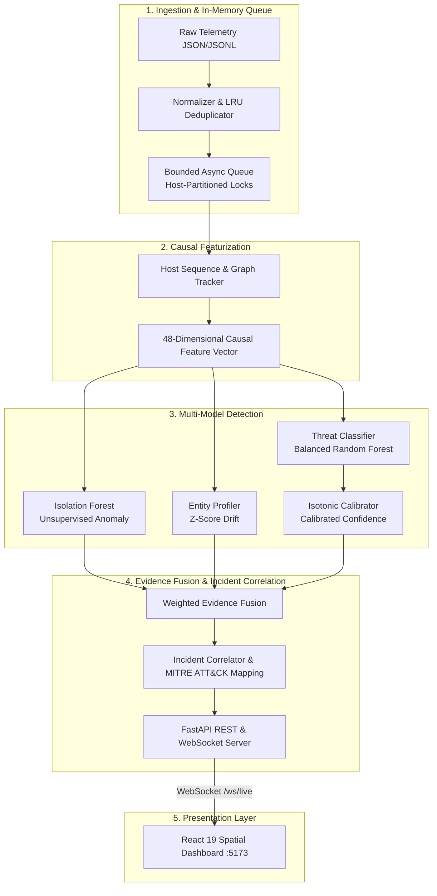

<div align="center">

# 🛡️ AEGIS-ML

### Multi-Layer Cyber Threat Detection & Incident Correlation Engine

**Release Candidate 1 (`v1.0.0-rc.1`)**

An asynchronous cyber defense platform that ingests heterogeneous security telemetry, extracts an immutable 48-dimensional causal feature contract, fuses supervised threat classification with unsupervised anomaly detection, and correlates multi-stage attacks along the **MITRE ATT&CK** kill chain into actionable incident dossiers.

[](https://python.org)
[](https://fastapi.tiangolo.com)
[](https://react.dev)
[](https://vitejs.dev)
[](https://scikit-learn.org)
[](tests/)
[](CHANGELOG.md)

[Quick Start](#-quick-start) · [Architecture](#-architecture-overview) · [Detection & Correlation](#-detection--correlation-pipeline) · [SOC Views](#-soc-analyst-views) · [API Endpoints](#-api--security-endpoints) · [Evaluation](#-evaluation-methodology--results) · [Honest Scope & Limitations](#-known-limitations--honest-scope)

</div>

---

## 📌 Project Status & Empirical Disclosure

**Current Stage: Release Candidate 1 (`v1.0.0-rc.1`)**  
AEGIS-ML features an end-to-end detection, probability calibration, and incident correlation pipeline verified across **336 passing automated tests**.

> [!IMPORTANT]
> **Synthetic Demo Data Disclosure:**  
> The default preloaded dataset (`behavioral_diversity_labeled.jsonl`) consists of scenario-grouped synthetic telemetry for demonstration and algorithm validation. Synthetic results validate rule correctness, merge prevention, and model calibration; **they do not establish real-world enterprise detection accuracy**. Evaluation against public CIC-IDS2017 releases remains strictly **BLOCKED** due to missing endpoint execution context and schema incompatibilities.

---

## 🌐 Problem Statement

Enterprise Security Operations Centers (SOCs) face two fundamental failure modes:
1. **Single-Signal Blind Spots:** Network-only signatures fail to detect host privilege escalation, while host-only EDR tools miss lateral traversal across subnets and external C2 tunneling.
2. **Alert Fatigue & Disconnection:** Independent alert streams inundate analysts with disconnected notifications, obscuring multi-stage campaigns.

AEGIS-ML addresses this by unifying **network flows, endpoint process executions, and application authentication logs** into a normalized stream, scoring each event across four independent models, and correlating alerts into unified incident timelines mapped to the **MITRE ATT&CK** kill chain.

---

## ⚡ Core Capabilities

- **Unified Telemetry Ingestion:** Enforces monotonic UTC timestamps and schema normalization across network, endpoint, and application domains.
- **Immutable 48-Feature Causal Assembly:** Extracts 48 backward-looking features combining behavioral baselines, relational graph topology, missingness flags, and per-host sequence transitions with zero forward temporal leakage.
- **Calibrated Multi-Model Inference:**
  - *Supervised Classification:* Balanced Random Forest classifying 5 canonical threat categories.
  - *Isotonic Probability Calibration:* Re-maps ensemble outputs into empirically calibrated posterior probabilities $\hat{P}(Y=c|X)$ (`calibrated_confidence`).
  - *Unsupervised Anomaly Detection:* Isolation Forest detecting out-of-profile zero-day outliers.
  - *Behavioral Deviation Profiling:* Z-score entity deviation for hosts and service accounts.
- **Incident Correlator:** Aggregates alerts sharing victim entities, pivot credentials, or infrastructure within rolling time windows into strongly-typed `Incident` clusters.
- **Fail-Closed Administrative Security:** Sensitive endpoints (`/api/model/reload`, `/api/ingest/reset`) enforce `AEGIS_ADMIN_KEY` authentication.
- **Spatial SOC Interface:** React 19 + Cytoscape + Three.js application with "Depth is Data" spatial tokens, WebSocket streaming (`/ws/live`), and mobile-responsive navigation.

---

## 🏗️ Architecture Overview



---

## 🔬 Detection & Correlation Pipeline

### 1. 48-Dimensional Causal Feature Schema (`PHASE22_BASELINE_FEATURE_NAMES`)
- **Base Behavioral & Telemetry (15):** Byte volumes, packet ratios, connection duration, port risk scores, failed auth rates, protocol encodings, entity deviation score, Isolation Forest baseline.
- **Relational Graph Topology (6):** Source out-degree, destination in-degree, bipartite ratio, multi-hop indicator, graph density, clustering coefficient.
- **Context & Privilege Flags (10):** Layer indicators, privilege flags, service account flags, business hours indicator, cross-subnet routing flag.
- **Explicit Missingness Indicators (5):** Binary indicators for missing parent process, missing user ID, missing payload hash, missing port, missing session token.
- **Host Sequence Transitions (12):** Rolling event rates, burst ratio, sequence transitions (auth $\rightarrow$ exec $\rightarrow$ network egress), time-delta variances.

### 2. Threat Taxonomy & MITRE ATT&CK Mapping
| Canonical Class | Description | Kill-Chain Stage |
|---|---|---|
| `benign` | Authorized enterprise traffic, normal workloads | N/A |
| `brute_force` | Credential stuffing, password spraying, repeated auth failures | Weaponize / Delivery |
| `lateral_movement` | Internal reconnaissance, PsExec execution, SMB credential reuse | Install |
| `c2_beaconing` | Periodic bot heartbeats, external command & control tunneling | Command & Control |
| `data_exfiltration` | High-volume outbound transfer, staging archive exfiltration | Exfiltrate |

---

## 🖥️ SOC Analyst Views

The frontend provides four dedicated operational views accessible via the top floating navigation rail:

1. **Dashboard (`/`)**:
   - Executive network pulse, throughput (EPS), processed event counter, and correlated incident tallies.
   - Real-time **Attack Topology Graph** and **Live Alert Feed** streaming from `/ws/live`.
   - Detailed **Incident Investigation Dossier** displaying timeline progressions, supporting events, and evidence provenance.
   - Analysis execution controls (`Start Analysis`, `Stop`).
2. **Threat Hunting (`/threat-hunting`)**:
   - Filterable search interface supporting complex criteria across severity, telemetry layer, and containment status.
   - Deep-dive entity telemetry dossiers and host quarantine simulation controls.
3. **Entity Graph (`/entity-graph`)**:
   - Full-canvas Cytoscape.js network topology viewer displaying observed flows and inferred pivot edges.
   - Graph controls: zoom, fit, relayout, node inspect, and kill-chain spatial depth projection.
4. **Reports (`/reports`)**:
   - Incident audit summaries and threat vector distribution analytics.
   - Raw audit export in JSON (`AEGIS-Security-Audit-Report.json`) and CSV formats.

---

## 🔐 API & Security Endpoints

| Method | Endpoint | Auth Required | Description |
|---|---|:---:|---|
| `GET` | `/health` / `/api/health` | No | Authentic health check returning backend status and classifier readiness. |
| `GET` | `/api/stats/summary` | No | Real-time aggregate telemetry statistics. |
| `GET` | `/api/alerts` | No | Recent alerts with calibrated confidence scores and feature importance. |
| `GET` | `/api/incidents` | No | Correlated incidents with multi-event timelines and supporting evidence. |
| `GET` | `/api/analysis/files` | No | Available analysis datasets (`.jsonl`, `.csv`, `.pcap`). |
| `POST`| `/api/analysis/start` | No | Initiates telemetry replay or live analysis stream. |
| `POST`| `/api/analysis/stop` | No | Terminates active telemetry processing. |
| `GET` | `/api/model/info` | No | Inspects loaded classifier metadata and calibration state. |
| `POST`| `/api/model/reload` | **`AEGIS_ADMIN_KEY`** | Reloads trained model artifacts from disk with fail-closed key validation. |
| `POST`| `/api/ingest/reset` | **`AEGIS_ADMIN_KEY`** | Flushes in-memory ingestion queues and reset trackers. |
| `WS`  | `/ws/live` | No | Bidirectional live telemetry WebSocket broadcast stream. |

---

## 🚀 Quick Start

### 1. Prerequisites
- Python 3.10+
- Node.js 18+ & npm
- Git

### 2. Setup Environment
```bash
git clone https://github.com/akashcodes23/AEGIS-ML.git
cd AEGIS-ML

# Python environment
python3 -m venv .venv
source .venv/bin/activate
pip install -r backend/requirements.txt

# Frontend dependencies
npm --prefix frontend install

# Environment configuration
cp .env.example .env
```

### 3. Run Backend & Frontend
**Terminal 1 — Backend:**
```bash
uvicorn backend.api.main:app --host 0.0.0.0 --port 8000 --reload
```

**Terminal 2 — Frontend:**
```bash
npm --prefix frontend run dev
```

Visit the dashboard at `http://localhost:5173`. Interactive OpenAPI docs are at `http://localhost:8000/docs`.

---

## 🧪 Verification & Test Suites

```bash
# 1. Full Pytest Suite (336 passing tests)
PYTHONPATH=. pytest tests/ -v

# 2. Frontend Unit & Depth Tests (18 passing tests)
node --test frontend/src/**/*.test.js

# 3. Frontend Production Build & Bundle Verification
npm --prefix frontend run build
```

---

## ⚠️ Known Limitations & Honest Scope

1. **In-Memory Queue Volatility:** The ingestion queue is held in memory (`asyncio.Queue`). Abnormal process termination will drop in-flight queue items. Zero-loss persistence across server restarts requires an external message broker (Kafka/RabbitMQ).
2. **Synthetic vs. Real-World Accuracy:** High reported benchmark metrics reflect controlled scenario-grouped synthetic fixtures. Enterprise production deployments face concept drift and novel attack vectors requiring ongoing baseline adaptation.
3. **Status of External Datasets (CIC-IDS2017 is BLOCKED):** Public CIC-IDS2017 releases lack endpoint execution context, user identities, and process lineage required by the 48-feature schema.
4. **Relational Analysis:** Graph metrics are computed deterministically via NetworkX rather than an end-to-end differentiable Temporal Graph Neural Network (T-GNN).
5. **No Kernel-Level Enforcement:** AEGIS-ML is a detection, scoring, and correlation engine; it does not deploy kernel-mode EDR drivers or automated firewall configuration agents.

---

## 📄 License & Release Metadata

- **Release:** `v1.0.0-rc.1` (Release Candidate 1)
- **License:** [Apache 2.0](LICENSE)
- **Maintainer:** [@akashcodes23](https://github.com/akashcodes23)
