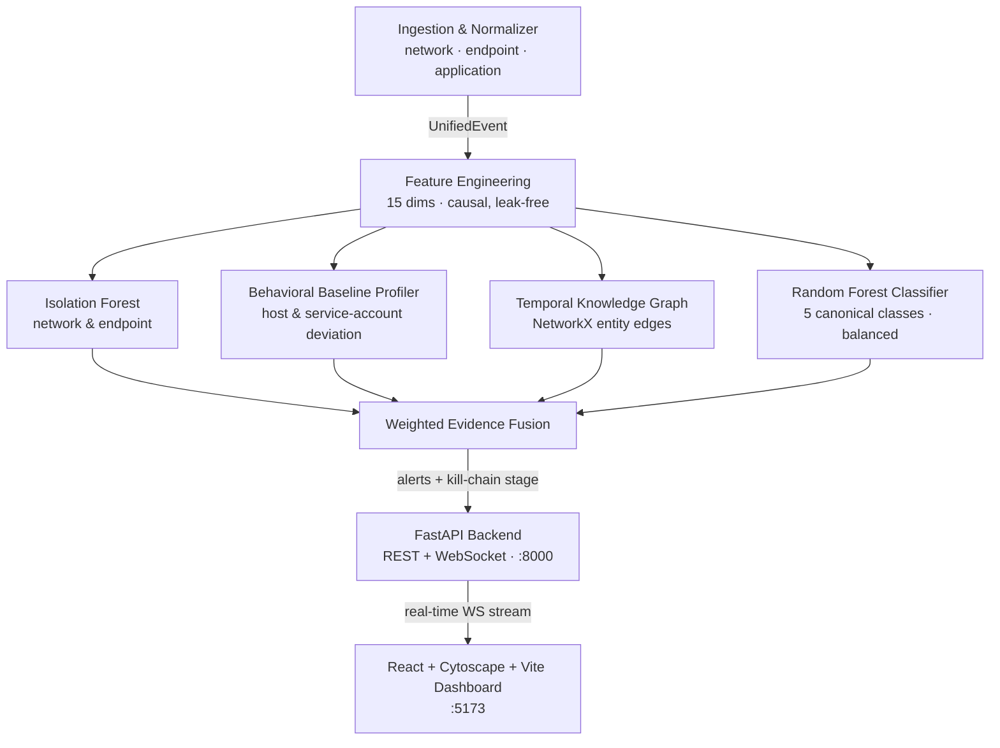

<div align="center">

# 🛡️ AEGIS-ML

### Enterprise Cyber Threat Intelligence & Anomaly Detection Pipeline

**Real-time, multi-layer cyber defense** that fuses supervised classification, unsupervised anomaly detection, behavioral profiling, and a temporal knowledge graph, then maps every alert to the **MITRE ATT&CK** kill chain.


[Quick Start](#-quick-start) · [Architecture](#-architecture) · [Training](#-training--evaluation) · [API](#-api-reference) · [Limitations](#-limitations--honest-scope)

</div>

---

## 🌐 Why AEGIS-ML?

Most detection tools rely on a single signal: a signature, a threshold, or one model. Attackers don't operate in one layer, so detection shouldn't either.

AEGIS-ML ingests **network flows, endpoint process logs, and application events**, normalizes them into one event schema, and scores each event with **four independent evidence sources**. These are then fused into a single, explainable alert with a kill-chain stage attached.

| | |
|---|---|
| 🧠 **Hybrid ML** | Random Forest (known attacks) + Isolation Forest (unknown anomalies) |
| 👤 **Behavioral baselines** | Per-host and per-service-account deviation profiling |
| 🕸️ **Temporal knowledge graph** | NetworkX entity-edge tracking to expose lateral movement paths |
| ⚖️ **Weighted evidence fusion** | One consensus verdict from IF + baselines + graph + RF |
| 🎯 **MITRE ATT&CK mapping** | Every alert is tagged with a kill-chain stage |
| 📡 **Live dashboard** | WebSocket-streamed alerts, topology graph, and stats |
| 🔒 **Leak-free MLOps** | Split-before-fit, SMOTE inside folds only, benign-only baselines |

---

## 🏗️ Architecture



### How a single event flows through the system

1. **Normalize**: raw telemetry becomes a `UnifiedEvent`, regardless of source.
2. **Featurize**: 15 causal features are extracted using time windows that never look into the future.
3. **Score in parallel**: anomaly (IF), behavioral drift, graph topology, and supervised class probability.
4. **Fuse**: a weighted combination produces a consensus verdict.
5. **Alert**: the result is mapped to a MITRE ATT&CK stage and pushed over WebSocket to the dashboard.

---

## 🎯 Threat Classes & MITRE Mapping

AEGIS-ML classifies telemetry into five canonical categories:

| Class | What it captures |
|---|---|
| `benign` | Normal business traffic, legitimate service polling, regular downloads |
| `brute_force` | Credential stuffing, repeated auth failures, password spraying |
| `lateral_movement` | Internal recon, PsExec usage, internal host port scanning |
| `c2_beaconing` | Periodic bot heartbeats, command & control, external tunneling |
| `data_exfiltration` | High-volume egress, archive staging, abnormal upload ratios |

### Third-party dataset normalization (e.g. CICIDS2017)

| Dataset label | Canonical class | Kill-chain stage |
|---|---|---|
| `BENIGN`, `Normal` | `benign` | N/A |
| `FTP-Patator`, `SSH-Patator`, `Web Attack - Brute Force` | `brute_force` | Weaponize / Delivery |
| `PortScan`, `Infiltration` | `lateral_movement` | Install |
| `Bot`, `DDoS`, `DoS Hulk`, `DoS GoldenEye` | `c2_beaconing` | Command & Control |
| `Heartbleed`, `Infiltration` (data egress) | `data_exfiltration` | Exfiltrate |
| *Unmapped / unknown labels* | *Flagged and reported in diagnostics* | *Under Review* |

> Unknown labels are never silently dropped. They are surfaced in training diagnostics.

---

## 🧪 Training & Evaluation

The pipeline is built to be **reproducible and leak-free**:

- ✅ **Split first**: an 80/20 train/holdout partition happens *before* any feature fitting.
- ✅ **SMOTE in-fold only**: resampling runs inside `imblearn.pipeline.Pipeline` training folds and is never applied to test data.
- ✅ **Clean baselines**: entity baselines are built only from benign training samples, which prevents baseline poisoning.
- ✅ **Honest benchmarking**: every model is compared against a stratified `DummyClassifier`.
- ✅ **Transparent artifacts**: weights, feature names, sklearn version, and JSON metrics are all saved.
- ✅ **Calibrated confidence**: isotonic calibration (`CalibratedClassifierCV`) maps raw tree votes to posterior probabilities.

### Saved artifacts (`data/models/`)

| File | Purpose |
|---|---|
| `threat_classifier.pkl` | Fitted Random Forest classifier |
| `isolation_forest_network.pkl` | Network Isolation Forest + scaling statistics |
| `isolation_forest_endpoint.pkl` | Endpoint Isolation Forest |
| `entity_baselines.pkl` | Behavioral profiles for internal hosts |
| `eval_results.json` | Machine-readable evaluation metrics |

<!--
  📊 Add your real holdout results here once you have them, for example:

  | Class | Precision | Recall | F1 |
  |---|---|---|---|
  | ... | ... | ... | ... |

  Generate them with: python3 -m backend.detection.model_trainer evaluate <untouched dataset>
  and copy the numbers from data/models/eval_results.json
-->

---

## ⚡ Quick Start

### Prerequisites

- Python **3.10+**
- Node.js **18+** and npm

### 1. Clone and configure

```bash
git clone https://github.com/akashcodes23/AEGIS-ML.git
cd AEGIS-ML

python3 -m venv venv
source venv/bin/activate          # Windows: venv\Scripts\activate

pip install -r backend/requirements.txt
cp .env.example .env              # Windows: copy .env.example .env
```

### 2. Generate synthetic attack scenarios *(skip if you have your own dataset)*

```bash
python3 -m backend.data_generator.orchestrator train
# → data/raw/combined_labeled.jsonl (multi-layer attack scenarios)
```

### 3. Train the models

```bash
# Default synthetic dataset
python3 -m backend.detection.model_trainer train

# Or your own CSV / JSONL
python3 -m backend.detection.model_trainer train path/to/dataset.csv
```

Evaluate saved models on an untouched dataset:

```bash
python3 -m backend.detection.model_trainer evaluate data/raw/combined_labeled.jsonl
```

### 4. Launch the backend

```bash
uvicorn backend.api.main:app --host 0.0.0.0 --port 8000 --reload
```

- 📖 Interactive API docs: <http://localhost:8000/docs>
- ❤️ Health check: <http://localhost:8000/health>

### 5. Launch the dashboard

```bash
cd frontend
npm install
npm run dev
```

Open <http://localhost:5173>.

### 6. Run the tests

```bash
pytest tests/ -v
```

21 tests covering dataset parsing, normalization, feature extraction, causal windowing, model validation, and API contracts. They need no external dataset.

---

## 📡 API Reference

### REST

| Method | Endpoint | Description |
|---|---|---|
| `GET` | `/health` | Service health, model readiness, dataset availability |
| `POST` | `/api/detect` | Run one `UnifiedEvent` through the full ML pipeline |
| `GET` | `/api/alerts` | Latest 100 detected alerts |
| `GET` | `/api/stats/summary` | Total events, alerts by severity, events per second |
| `GET` | `/api/model/lifecycle` | Active model version, calibration status, schema version |
| `POST` | `/api/model/validate` | Dry-run validation of a candidate model artifact |
| `POST` | `/api/model/reload` | Safe hot-swap of a candidate model, with rollback protection |
| `GET` | `/api/analysis/files` | List available dataset files |
| `POST` | `/api/analysis/start` · `/stop` | Start or stop streaming dataset analysis |
| `POST` | `/api/incident/{event_id}/remediate` | Mark an incident as resolved |
| `POST` | `/api/incident/{event_id}/isolate` | Kill-switch: isolate the compromised source entity |

### WebSocket

`ws://localhost:8000/ws/live` streams three event types in real time:

| Message | Payload |
|---|---|
| `new_alert` | A freshly fused alert with severity and kill-chain stage |
| `graph_update` | Topology changes for the Cytoscape view |
| `stats_update` | Rolling aggregate statistics |

---

## 🛠️ Tech Stack

| Layer | Technology |
|---|---|
| **API** | FastAPI · Uvicorn · WebSockets · Pydantic v2 |
| **Frontend** | React 19 · Vite · Cytoscape.js · Recharts |
| **Supervised ML** | scikit-learn Random Forest (`class_weight="balanced"`) |
| **Unsupervised ML** | scikit-learn Isolation Forest (`contamination=0.05`) |
| **Resampling** | imbalanced-learn (`ImbPipeline` + SMOTE, train folds only) |
| **Graph analysis** | NetworkX temporal knowledge graph |
| **Serialization** | Joblib / Pickle with metadata verification |
| **Testing** | pytest · pytest-asyncio · FastAPI TestClient |

---

## 📁 Project Structure

```
AEGIS-ML/
├── backend/          # FastAPI app, detection pipeline, data generators
├── frontend/         # React + Vite + Cytoscape dashboard
├── data/             # Raw datasets and trained model artifacts
├── docs/             # Project documentation
├── tests/            # pytest suite
├── export.py         # Export utility
├── .env.example      # Environment template
└── README.md
```

---

## ⚠️ Limitations & Honest Scope

AEGIS-ML is a research-grade platform, and its limits are stated up front:

1. **Calibration is benchmark-bound.** Isotonic calibration was fitted and evaluated on synthetic scenarios. Calibrated scores do not guarantee real-world risk levels in an unmonitored enterprise.
2. **Tabular + graph metrics, not a deep graph model.** The system combines NetworkX topology features with tree ensembles. A deep Temporal GNN is on the roadmap.
3. **Synthetic and CICIDS2017 results are not production proof.** Real deployment needs continuous baseline adaptation and ongoing false-positive tuning.

---

## 🗺️ Roadmap

- [ ] PyTorch Temporal Graph Neural Network (T-GNN) for deep relational detection
- [ ] Continuous baseline adaptation to handle concept drift
- [ ] Analyst feedback loop for false-positive recalibration
- [ ] Containerized deployment (Docker Compose)
- [ ] Additional real-world benchmark datasets

---

## 🤝 Contributing

Issues and pull requests are welcome.

1. Fork the repo and create a feature branch.
2. Add or update tests, and make sure `pytest tests/ -v` passes.
3. Open a pull request describing the change.

---

## 📄 License

<!-- Add a LICENSE file (MIT is a common choice) and update this line. -->
No license specified yet.

---

<div align="center">

**Built by [@akashcodes23](https://github.com/akashcodes23)**

⭐ If AEGIS-ML is useful to you, consider starring the repo.

</div>
