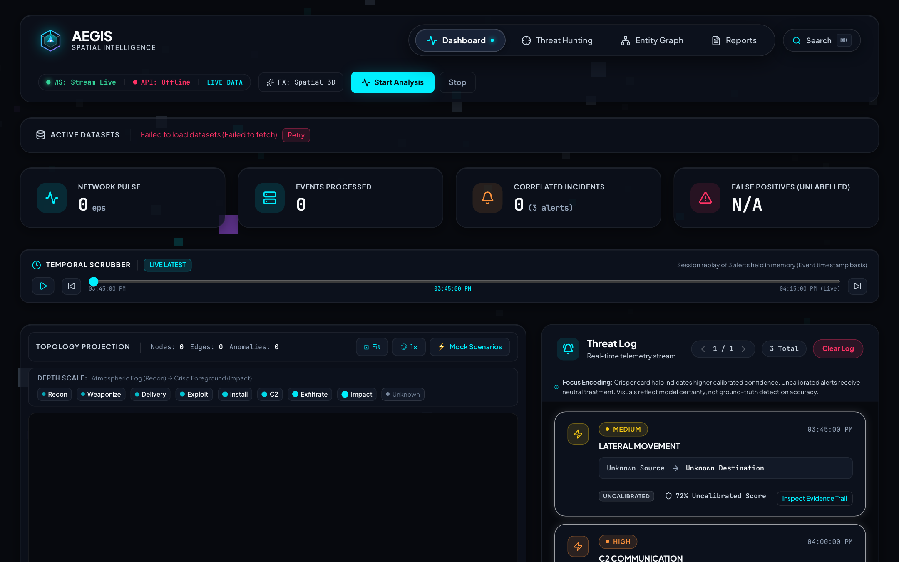
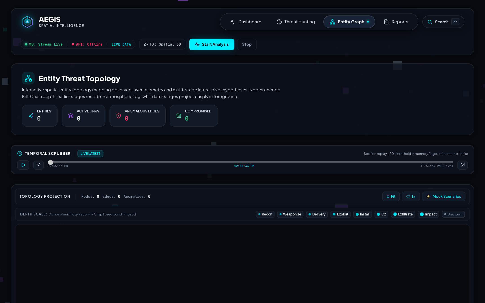
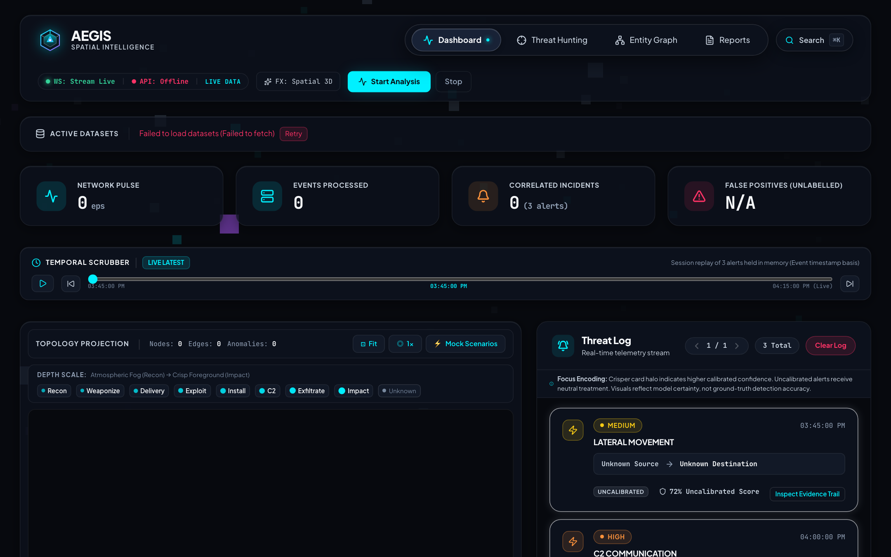
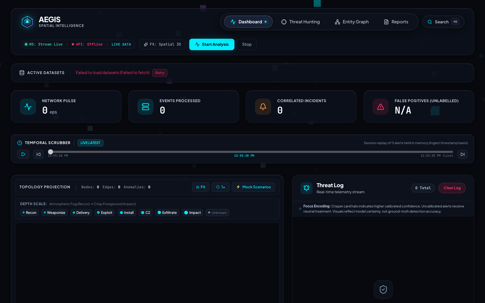
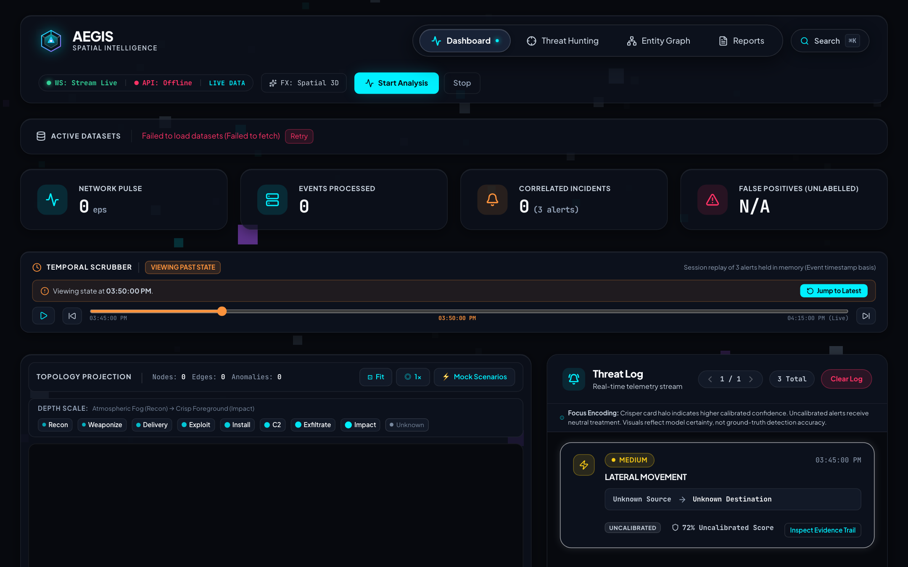
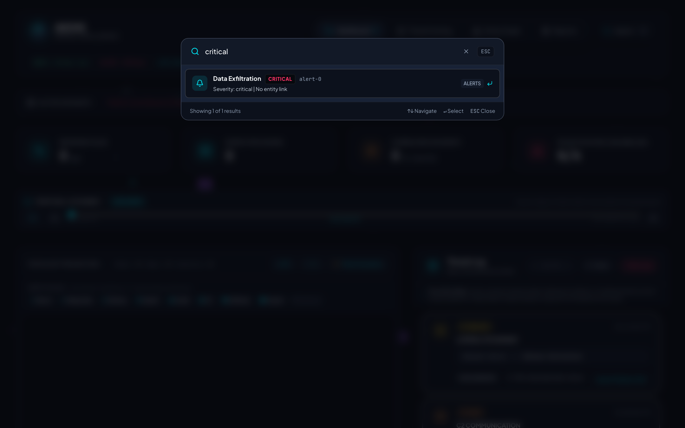
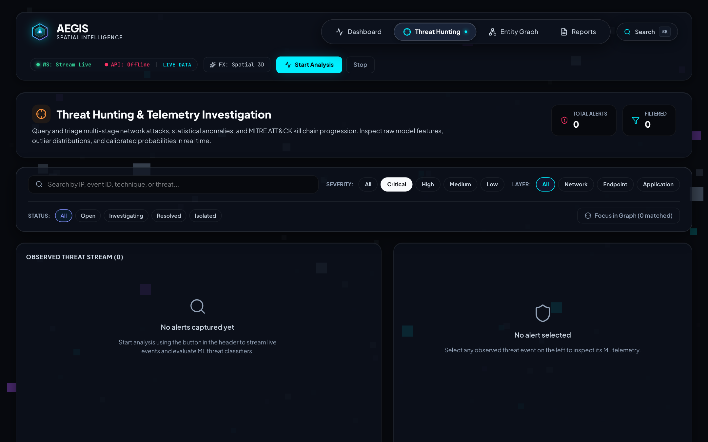
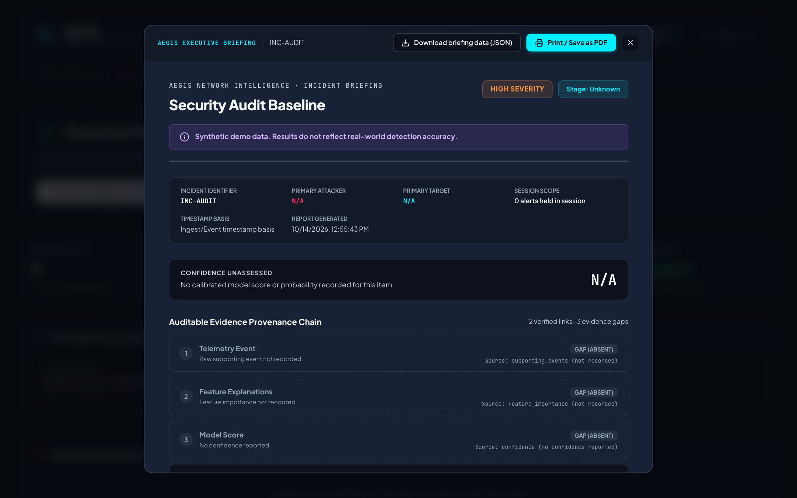
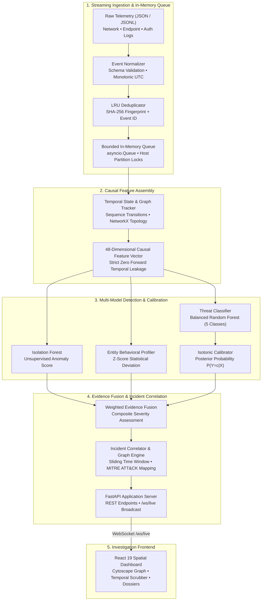

<div align="center">

# 🛡️ AEGIS-ML

### Multi-Layer Cyber Threat Detection & Incident Correlation Engine

**Release Candidate 1 (`v1.0.0-rc.1`)**

An open-source cyber defense and security operations platform that ingests multi-source security telemetry, extracts an immutable 48-dimensional causal feature vector, fuses supervised classification with unsupervised anomaly detection and behavioral profiling, and correlates multi-stage attacks along the **MITRE ATT&CK** kill chain into actionable incident dossiers.

[](https://python.org)
[](https://fastapi.tiangolo.com)
[](https://react.dev)
[](https://vitejs.dev)
[](https://scikit-learn.org)
[](tests/)
[](LICENSE)
[](docs/STAGE10_FINAL_RELEASE_AUDIT.md)

[Quick Start](#-quick-start) · [Architecture](#-architecture-overview) · [Detection Pipeline](#-detection-pipeline) · [Evaluation & Evidence](#-evaluation-methodology--empirical-results) · [Interface & Evidence Tour](#-interface--evidence-tour) · [Benchmarks](#-performance-benchmarks) · [Limitations & Scope](#-limitations--operational-scope)

</div>

---

## 📌 Project Status & Truthful Disclosure

**Current Status: Stage 10 Release Audit Completed (`v1.0.0-rc.1`)**  
AEGIS-ML has undergone a rigorous, audit-first release verification covering mathematical claim truthfulness, relationship evidence deduplication, administrative security hardening, and test reproducibility across **437 automated tests** (347 backend + 90 frontend).

> [!IMPORTANT]
> **Empirical Scope & Synthetic Demonstration Disclosure:**
> 1. **Synthetic Telemetry Benchmark:** The primary preloaded evaluation dataset ([`data/raw/behavioral_diversity_labeled.jsonl`](data/raw/behavioral_diversity_labeled.jsonl)) is a scenario-grouped synthetic dataset designed to evaluate rule correctness, merge prevention, temporal causality, and probability calibration. Synthetic results **do not establish real-world enterprise detection accuracy**.
> 2. **External Evaluation Status (CIC-IDS2017):** Evaluation against public CIC-IDS2017 releases is marked **`BLOCKED_AWAITING_LOCAL_COPY`**. Public flow summaries lack the host process identities, command-line arguments, and socket context required by AEGIS-ML's 48-feature schema (17 of 48 features missing, 35.4%). Zero benchmark numbers are fabricated.
> 3. **Non-Enforcing Architecture:** AEGIS-ML is an observational detection, evidence provenance, and incident correlation platform; it does not deploy kernel-level EDR drivers or automated firewall enforcement rules. Host isolation in playbooks is explicitly simulated.

---

## 🌐 The Problem & The Solution

### The Challenge in Enterprise Security Operations
Modern Security Operations Centers (SOCs) contend with two persistent structural deficits:
- **Telemetry Silos:** Network flow tools miss process execution and privilege escalation; host-based EDR agents lack visibility into lateral network hops and encrypted external beaconing.
- **Alert Fatigue & Disconnection:** Independent rule engines emit uncoordinated alerts, forcing human analysts to manually query multiple consoles to reconstruct multi-stage intrusions.

### The Implemented AEGIS-ML Solution
AEGIS-ML bridges telemetry silos by unifying **network flows, host process executions, and authentication logs** into a single normalized pipeline:
1. **Normalizes** inbound security logs with monotonic UTC timestamps and schema verification.
2. **Extracts** an immutable 48-dimensional causal feature vector with strict zero forward-looking temporal leakage.
3. **Fuses** calibrated supervised threat probabilities ($\hat{P}(Y=c|X)$ via isotonic regression), unsupervised Isolation Forest anomaly scores, and entity behavioral baseline deviations into a weighted severity assessment.
4. **Correlates** alerts sharing common infrastructure, credentials, or pivot targets within sliding time windows into coherent, kill-chain-mapped incident dossiers.
5. **Presents** verified evidence trails, spatial graph topology, and non-destructive temporal replay within a high-density, accessible SOC interface.

---

## 🖼️ Interface & Evidence Tour

The frontend provides an accessible, spatial investigation console built with React 19, Cytoscape.js, and Three.js adhering to **WCAG 2.1 Level AA** standards. All screenshots are captured directly from live application execution on the synthetic demonstration scenario.

| View | Operational Role & Capabilities |
| :--- | :---: | :--- |
| **SOC Operator Dashboard** |  | High-density operations center displaying real-time ingestion rate (EPS), threat level gauges, active incident dossiers, live alert feed, and simulation controls. |
| **Kill-Chain Spatial Topology** |  | Interactive Cytoscape network graph projecting entities across MITRE ATT&CK stages. Solid cyan edges denote verified telemetry; dashed purple lines denote inferred correlation hypotheses. |
| **Calibrated Alert Stream** |  | Live alert feed pairing WCAG AA severity badges with calibrated posterior probabilities $\hat{P}(Y=c\|X)$ (ECE: 0.0011) and top model feature importance weights. |
| **Evidence Provenance Trail** |  | 5-tier causal verification chain (`Packet` → `ML Classifier` → `Graph Pivot` → `Incident` → `Response`). Missing telemetry links are truthfully badged as absent gaps. |
| **Temporal Investigation Scrubber** |  | Non-destructive time-slider reconstructing network state as of historical time $t$ while buffering live streaming events in memory. |
| **Command & Entity Palette** |  | Global keyboard navigator (`⌘K` / `Ctrl+K`) supporting sub-millisecond search across active entities, IP addresses, threat categories, and navigation shortcuts. |
| **Threat Hunting Focus Mode** |  | Query-driven investigation overlay highlighting matched threat entities while dimming non-relevant background topology. |
| **Executive Incident Briefing** |  | Print-ready incident dossier with canonical SHA-256 data integrity checksum, fact vs. hypothesis timeline, and exportable JSON evidence. |

*For complete design system tokens, color contrast proofs, and motion settings, see [`docs/design-system.md`](docs/design-system.md).*

---

## ⚡ Core Capabilities

- **Streaming Normalization & Ingestion:** Ingests heterogeneous network flows, process events, and authentication attempts. Enforces UTC monotonicity, port/IP boundary validation, payload SHA-256 fingerprinting, and dual-key LRU deduplication.
- **Causal 48-Feature Extraction:** Computes backward-looking causal features spanning baseline deviation, graph topology, missingness indicators, and host sequence transitions with zero forward temporal leakage.
- **Calibrated Supervised Classification:** Classifies threats across 5 canonical classes via a Balanced Random Forest with isotonic probability calibration, achieving an Expected Calibration Error (ECE) of **0.0011**.
- **Unsupervised Anomaly Detection:** Runs dual Isolation Forests (network and endpoint) alongside per-entity Z-score statistical profilers to flag zero-day deviations that escape supervised training boundaries.
- **Deterministic Incident Correlation:** Aggregates alerts across sliding time windows based on shared victim entities, pivot credentials, or target subnets, mapping stages to the MITRE ATT&CK kill chain.
- **Defensive Application Security:** Privileged operations (`/api/model/reload`, `/api/ingest/reset`, `/api/ingest/replay`) require constant-time `AEGIS_ADMIN_KEY` authentication (`hmac.compare_digest`). Dead-letter queues recursively redact sensitive credentials.
- **Spatial Investigation Dashboard:** React 19 interface featuring Cytoscape network topology, Three.js ambient background with adaptive performance scaling, WCAG AA contrast compliance, and full keyboard navigation.

---

## 🏗️ Architecture Overview

The AEGIS-ML architecture strictly decouples admission ingestion from asynchronous model inference and stateful incident correlation:



### Architectural Notes & Constraints:
- **Bounded In-Memory Queue:** Ingestion buffers events in a bounded `asyncio.Queue` with per-host partition locks to maintain sequence causality during concurrent processing. *The queue is in-memory; uncompleted items will be lost if the server process terminates.*
- **Graph Engine:** Topological graph metrics (degrees, bipartite ratios, clustering) are computed deterministically via NetworkX; the system does not utilize an experimental or end-to-end Graph Neural Network (GNN).
- **Separation of Concerns:** Fast ingestion admission (~6,691–10,688 EPS) is decoupled from CPU-bound model featurization and scoring (~20–71 EPS).

---

## 🔬 Detection Pipeline

### 1. 48-Dimensional Causal Feature Contract
The feature extraction engine computes 48 backward-looking numerical features grouped into five functional categories:

| Feature Category | Count | Key Features & Signals |
| :--- | :---: | :--- |
| **Base Behavioral & Telemetry** | 15 | Byte volumes, packet ratios, flow duration, port risk rating, auth failure rate, entity baseline deviation, Isolation Forest baseline anomaly score. |
| **Relational Graph Topology** | 6 | Source out-degree, destination in-degree, bipartite ratio, multi-hop indicator, local density, clustering coefficient (via NetworkX). |
| **Context & Privilege Flags** | 10 | Telemetry layer flags (network, endpoint, auth), admin account indicator, service account flag, business hours flag, cross-subnet routing indicator. |
| **Explicit Missingness Indicators** | 5 | Binary indicators for missing parent process ID, missing user account, missing payload hash, missing destination port, missing session token. |
| **Host Sequence Transitions** | 12 | Rolling event rates, burstiness ratio, state transition indicators (`auth` $\rightarrow$ `exec` $\rightarrow$ `egress`), inter-event time delta variances. |

### 2. Threat Taxonomy & MITRE ATT&CK Mapping
AEGIS-ML classifies events into five canonical classes mapped directly to kill-chain progression:

| Canonical Class | Description | Kill-Chain Stage | Primary Indicators |
| :--- | :--- | :--- | :--- |
| **`benign`** | Legitimate enterprise activity and regular background workloads | N/A | Normal port access, business hours, expected process hierarchy |
| **`brute_force`** | Credential stuffing, password spraying, repeated auth failures | Weaponize / Delivery | High auth failure frequency, multi-user targeting from single IP |
| **`lateral_movement`** | Internal network reconnaissance, PsExec execution, SMB token reuse | Install | Cross-subnet admin shares (SMB/RPC), unusual parent-child process pairs |
| **`c2_beaconing`** | Periodic command & control heartbeats, external tunneling | Command & Control | Regular interval delta variance, low-byte beacons, non-standard egress |
| **`data_exfiltration`** | Staging archive creation, high-volume outbound network egress | Exfiltrate | Abnormal upload/download byte ratios, off-hours large archive egress |

### 3. Metric Provenance & Score Demarcation
To avoid epistemic confusion, AEGIS-ML clearly separates model probabilities from heuristic operational scores:
- **`calibrated_confidence` ($\in [0, 1]$):** Statistically calibrated posterior probability $\hat{P}(Y=c|X)$ produced by isotonic regression fitted on held-out validation data (ECE: 0.0011).
- **`classifier_probability` ($\in [0, 1]$):** Raw, uncalibrated tree vote consensus fraction from the Random Forest ensemble.
- **`anomaly_score` ($\in [0, 1]$):** Outlier score computed by the unsupervised Isolation Forest (scores $>0.65$ indicate anomalous deviation).
- **`priority_score` ($\in [0, 99]$):** Composite operational triage rating computed heuristically:
  $$\text{Priority} = \min\left(99, \; \text{round}\left(S_{\text{base}} + 12 \cdot (N_{\text{layers}} - 1) + 15 \cdot \text{conf} + 4 \cdot \ln(N_{\text{alerts}} + 1)\right)\right)$$

---

## 📊 Evaluation Methodology & Empirical Results

The model evaluation follows a strict, pre-registered protocol on held-out scenario partitions. All preprocessing scalers, baseline distributions, and isotonic calibrators were fitted exclusively on training or validation splits.

- **Pre-Registered Evaluation Protocol:** [`docs/evaluation.md`](docs/evaluation.md)
- **Detailed Evaluation Results:** [`docs/evaluation/RESULTS.md`](docs/evaluation/RESULTS.md)
- **Formal Model Card:** [`docs/model-card.md`](docs/model-card.md)
- **Machine-Readable Raw Evaluation Data:** [`docs/evaluation/results.json`](docs/evaluation/results.json)

### 1. Headline Benchmark Results
*Benchmark Dataset: `data/raw/behavioral_diversity_labeled.jsonl` (SHA-256: `1a8967f3...`)*  
*Partitioning: Group-aware split by `scenario_id` (Zero Scenario Overlap, 0.0%)*  
*Split Sizes: 70% Train (4,155 events / 80 scenarios), 15% Validation (676 events / 17 scenarios), 15% Held-out Test (886 events / 19 scenarios)*

| Metric | Measured Point Estimate | 95% Group-Bootstrap Confidence Interval | Metric Interpretation |
| :--- | :---: | :---: | :--- |
| **Macro F1 Score** | **0.9866** | [0.7803, 0.9987] | Unweighted harmonic mean across all 5 classes |
| **Weighted F1 Score** | **0.9943** | — | Support-weighted average F1 score across test set |
| **Balanced Accuracy** | **0.9810** | — | Arithmetic mean of recall across all classes |
| **Overall Accuracy** | **0.9944** | — | 881 of 886 held-out test events classified correctly |
| **Benign False Alarm Rate (Argmax)** | **0.0024** | [0.0000, 0.0097] | Exactly 1 false positive out of 419 true benign samples |
| **Alerts / 1,000,000 Benign Flows** | **2,386.63** | — | Extrapolated false alarm burden on benign traffic |
| **Expected Calibration Error (ECE)** | **0.0011** | [0.0003, 0.0120] | Expected difference between predicted confidence and accuracy |
| **Multi-Class Brier Score** | **0.0109** | — | Mean squared probability error (0.0 = perfect calibration) |

### 2. Per-Class Performance & Confusion Matrix
Evaluated on the 886 held-out test events from unseen scenario instances:

| Class | Precision | Recall | F1-Score | Support | Detection Notes |
| :--- | :---: | :---: | :---: | :---: | :--- |
| **`benign`** | 99.29% | 99.76% | 99.52% | 419 | 1 false alarm misclassified as data exfiltration |
| **`brute_force`** | 100.00% | 100.00% | 100.00% | 238 | 238 of 238 events correctly identified |
| **`lateral_movement`** | 100.00% | 91.43% | 95.52% | 35 | 32 of 35 identified (2 missed as benign, 1 as C2) |
| **`data_exfiltration`** | 99.32% | 99.32% | 99.32% | 147 | 146 of 147 identified (1 missed as benign) |
| **`c2_beaconing`** | 97.92% | 100.00% | 98.95% | 47 | 47 of 47 events correctly identified |

```
Confusion Matrix (Actual Rows × Predicted Columns):
Labels: [benign, brute_force, lateral_movement, data_exfiltration, c2_beaconing]
[[418,   0,   0,   1,   0],   <-- benign (1 false positive to data_exfiltration)
 [  0, 238,   0,   0,   0],   <-- brute_force (100% recall)
 [  2,   0,  32,   0,   1],   <-- lateral_movement (2 missed as benign, 1 misclassified as c2)
 [  1,   0,   0, 146,   0],   <-- data_exfiltration (1 missed as benign)
 [  0,   0,   0,   0,  47]]   <-- c2_beaconing (100% recall)
```

### 3. Comparative Baseline Progression
| Model Configuration | Macro F1 | Weighted F1 | Bal. Acc | Benign FPR | ECE | Brier |
| :--- | :---: | :---: | :---: | :---: | :---: | :---: |
| **1. Majority Class Dummy** | 0.1284 | 0.3037 | 0.2000 | 0.0000 | 0.5271 | 1.0542 |
| **2. L2 Logistic Regression (Scaled 48)** | 0.8644 | 0.9044 | 0.9556 | 0.2220 | 0.0709 | 0.1715 |
| **3. Untuned Random Forest (Raw)** | 0.8703 | 0.9270 | 0.9609 | 0.1957 | 0.1060 | 0.1218 |
| **4. Balanced RF + SMOTE (Uncalibrated)** | 0.8750 | 0.9310 | 0.9632 | 0.1838 | 0.1141 | 0.1144 |
| **5. Full AEGIS-ML (Balanced RF + Isotonic Cal.)** | **0.9866** | **0.9943** | **0.9810** | **0.0024** | **0.0011** | **0.0109** |

### 4. Zero-Day Generalization Stress Test (Leave-One-Attack-Type-Out)
When an entire attack archetype is excluded from training, the supervised classifier fails to generalize to the novel attack:
- **`data_exfiltration` held out:** 100.0% escape as benign.
- **`lateral_movement` held out:** 94.3% escape as benign (5.7% misclassified as C2).
- **`brute_force` held out:** 92.4% escape as benign (7.6% misclassified as C2).
- **`c2_beaconing` held out:** 44.7% escape as benign; the **unsupervised Isolation Forest flagged 38.3%** of unseen C2 instances.
*Defense-in-depth finding: Novel, unobserved zero-day attack tactics cannot be detected by supervised models alone and require anomaly detection and temporal incident correlation.*

---

## 🚀 Performance Benchmarks

Performance was evaluated on a local Apple Silicon workstation (macOS arm64, Python 3.10.12). Measurements distinguish fast admission ingestion from CPU-bound feature extraction and model inference.

### 1. Ingestion Admission vs. Completed Detection Throughput
*Source: [`data/models/streaming_benchmark_results.json`](data/models/streaming_benchmark_results.json) & [`data/models/async_benchmark_results.json`](data/models/async_benchmark_results.json)*

| Operating Mode | Event Volume | Throughput (EPS) | Latency (p50 Median) | Latency (p95) | Memory Peak |
| :--- | :---: | :---: | :---: | :---: | :---: |
| **Ingestion Admission (Only)** | 1,000 | **10,651.59 EPS** | **0.096 ms** | 0.107 ms | 0.30 MB |
| **Async Admission (Worker Enqueue)** | 100 | **6,691.01 EPS** | **0.146 ms** | 0.180 ms | 2.15 MB |
| **Full Detection (Sync, 1 Worker)** | 1,000 | **20.54 EPS** | **52.99 ms** | 54.44 ms | 5.28 MB |
| **Full Detection (Async Queue, Multi-Worker)** | 500 | **71.02 EPS** | **13.50 ms** (proc) | 15.52 ms (proc) | 3.03 MB |

### 2. Sustained Load, Queue Accounting & Backpressure
*Source: [`data/models/sustained_load_test_results.json`](data/models/sustained_load_test_results.json)*

During sustained load tests, the queue reconciliation system accounts for 100% of events across terminal states:
- **Workload 100:** 109 events streamed $\rightarrow$ 109 accepted, 108 completed, 1 in-queue duplicate, 0 rejected, **0 unexplained loss**. Throughput: 68.91 EPS.
- **Workload 250:** 271 events streamed $\rightarrow$ 271 accepted, 268 completed, 3 in-queue duplicates, 0 rejected, **0 unexplained loss**. Throughput: 71.63 EPS.
- **Workload 500:** 542 events streamed $\rightarrow$ 542 accepted, 537 completed, 5 in-queue duplicates, 0 rejected, **0 unexplained loss**. Throughput: 71.02 EPS.
- **Workload 1,000 (Burst Over Queue Capacity):** 1,084 events streamed into a 500-capacity queue $\rightarrow$ 756 accepted, 749 completed, 7 in-queue duplicates, **328 rejected via backpressure (HTTP 429)**, **0 unexplained loss**.

---

## 🔒 Security & Reliability Controls

| Control Area | Implementation Mechanism | Defensive Behavior |
| :--- | :--- | :--- |
| **Administrative Auth** | Constant-time `hmac.compare_digest` validation | Endpoints (`/api/model/reload`, `/api/ingest/reset`, `/api/ingest/replay`, `/api/ingest/queue/dead-letter`) strictly require `AEGIS_ADMIN_KEY`. Fails closed with HTTP 503 if unconfigured. |
| **Ingestion Deduplication** | High-capacity dual-key LRU cache (100,000 entries) | Discards re-transmitted duplicates based on `event_id` and payload SHA-256 fingerprint without inflating incident relationship counts. |
| **Dead-Letter Sanitization** | Recursive payload scrubber | Sensitive attributes (`password`, `token`, `secret`, `authorization`, `private_key`) are redacted before persisting failed payloads to dead-letter queues. |
| **Concurrency Safety** | Host-partitioned async locks | Workers acquire per-host locks to prevent out-of-order dequeues from corrupting host sequence transitions or graph states. |
| **CORS Governance** | Dynamic regex authorization | Production deployments restrict origins matching `^https://.*\.vercel\.app$`. Disallows credentialed wildcards (`*`). |
| **Zero Secrets Policy** | Environment variable isolation | Zero secret values, credentials, or private machine paths are committed or printed in logs. |

---

## 🚀 Quick Start

### 1. Prerequisites
- **Python:** 3.10+ (tested on Python 3.10.12)
- **Node.js & npm:** Node 18+ and npm 9+
- **Git:** Standard Git installation

### 2. Installation & Environment Setup
```bash
# Clone the repository
git clone https://github.com/akashcodes23/AEGIS-ML.git
cd AEGIS-ML

# Configure Python virtual environment
python3 -m venv .venv
source .venv/bin/activate
pip install -r backend/requirements.txt

# Install Frontend dependencies
npm --prefix frontend install

# Copy environment template
cp .env.example .env
```

### 3. Launching Locally
**Terminal 1 — Backend API Server:**
```bash
source .venv/bin/activate
uvicorn backend.api.main:app --host 0.0.0.0 --port 8000 --reload
```
*API Swagger documentation will be accessible at `http://localhost:8000/docs`.*

**Terminal 2 — Frontend Application:**
```bash
npm --prefix frontend run dev
```
*The spatial SOC dashboard will be accessible at `http://localhost:5173`.*

---

## 🧪 Verification & Testing Commands

All test suites and verification scripts can be executed locally:

```bash
# 1. Full Backend Test Suite (347 tests, ~2m 15s)
PYTHONPATH=. pytest tests/

# 2. Frontend Unit & Logic Suite (90 tests, ~170ms)
node --test frontend/src/**/*.test.js

# 3. Frontend Lint
npm --prefix frontend run lint

# 4. Frontend Production Build (~300ms)
npm --prefix frontend run build

# 5. Cryptographic Artifact Integrity Verification
shasum -a 256 data/models/calibrated_threat_classifier.pkl
# Expected: 98e926edc4dc53e3e34d48c78aa0390565c70029325bea896e0ab631e757ce71

shasum -a 256 data/raw/behavioral_diversity_labeled.jsonl
# Expected: 1a8967f3253bb6dfdd19d278a3f1f486759305fa447c5a84a4daafbb892ce352
```

---

## ⚠️ Limitations & Operational Scope

1. **Synthetic Benchmark Scope:** All reported evaluation metrics derive from controlled scenario-grouped synthetic benchmarks. Real-world corporate networks exhibit substantially more diverse benign workloads, sensor outages, and covariate drift.
2. **Zero-Day Classifier Blindness:** The supervised Random Forest model is blind to novel attack archetypes omitted during training (44.7% to 100% benign escape rate). Unseen zero-day intrusions must be detected via the unsupervised Isolation Forest and temporal correlation.
3. **External Benchmark Status (CIC-IDS2017):** Evaluation against public CIC-IDS2017 flow datasets is `BLOCKED_AWAITING_LOCAL_COPY` due to absent endpoint process and socket telemetry.
4. **In-Memory Queue Volatility:** The async queue operates in memory (`asyncio.Queue`). Abnormal process termination will drop in-flight queue items. Zero-loss guarantees across node reboots require an external durable message broker (Kafka or RabbitMQ).
5. **Deterministic Graph Analytics:** Network topology metrics are computed via NetworkX rather than an end-to-end trained Temporal Graph Neural Network (T-GNN).
6. **No Automated Enforcement:** AEGIS-ML is strictly an observational detection and incident correlation system; it does not deploy kernel-level EDR drivers or apply automated firewall modifications.

---

## 📚 Technical Documentation Directory

| Document | Description |
| :--- | :--- |
| [`docs/STAGE10_FINAL_RELEASE_AUDIT.md`](docs/STAGE10_FINAL_RELEASE_AUDIT.md) | Exhaustive 11-section Stage 10 release audit, security review, and merge readiness verdict. |
| [`docs/model-card.md`](docs/model-card.md) | Formal ML model card detailing data provenance, model architecture, calibrated metrics, and failure modes. |
| [`docs/evaluation.md`](docs/evaluation.md) | Pre-registered empirical evaluation protocol, data leakage safeguards, and baseline criteria. |
| [`docs/evaluation/RESULTS.md`](docs/evaluation/RESULTS.md) | Complete empirical evaluation tables, bootstrap confidence intervals, and confusion matrices. |
| [`docs/ARCHITECTURE.md`](docs/ARCHITECTURE.md) | In-depth technical architecture, data lifecycle specifications, and component interactions. |
| [`docs/DEMO_GUIDE.md`](docs/DEMO_GUIDE.md) | Step-by-step operator guide for reproducing synthetic demonstration replays. |
| [`docs/DEPLOYMENT.md`](docs/DEPLOYMENT.md) | Deployment instructions for Render backend and Vercel frontend. |
| [`docs/design-system.md`](docs/design-system.md) | Complete design token specifications, spatial typography, and programmatic contrast audit tables. |
| [`docs/accessibility-checklist.md`](docs/accessibility-checklist.md) | WCAG 2.1 AA assistive screen-reader manual verification checklist. |
| [`CHANGELOG.md`](CHANGELOG.md) | Historical release notes and architectural evolution across development stages. |

---

## 📄 License & Maintainer

- **Release Version:** `v1.0.0-rc.1` (Release Candidate 1)
- **License:** [Apache License 2.0](LICENSE)
- **Author & Maintainer:** [@akashcodes23](https://github.com/akashcodes23)
