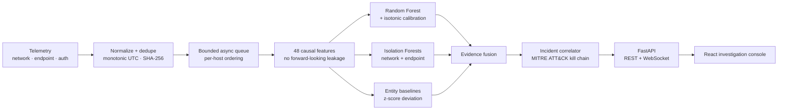

<div align="center">

# 🛡️ AEGIS-ML

### Multi-layer threat detection with evidence you can audit

Network, endpoint, and authentication telemetry in. Calibrated detections, kill-chain incidents, and an investigation console that shows what it knows, what it doesn't, and how it got there.

<br/>


<sub>Synthetic demonstration scenario. Not real network data.</sub>

<br/><br/>

[](CHANGELOG.md)
[](https://python.org/)
[](https://fastapi.tiangolo.com/)
[](https://react.dev/)
[](https://scikit-learn.org/)
[](tests/)
[](LICENSE)

<br/>

[Quick Start](#-quick-start) · [Visual Tour](#-visual-tour) · [Architecture](#-architecture) · [Evidence](#-evidence-what-the-numbers-do-and-dont-say) · [Limitations](#-limitations)

</div>

---

## ✨ In 30 seconds

| Aspect | Detail |
| :--- | :--- |
| **What it is** | A detection, evidence-provenance, and incident-correlation platform with an accessible investigation UI. |
| **How it works** | 48 causal features feed a calibrated Random Forest, two Isolation Forests, and per-entity baselines. Their outputs are fused and correlated into MITRE ATT&CK kill-chain incidents. |
| **What's unusual** | It publishes its failure modes, shows missing evidence as explicit gaps, and separates calibrated probabilities from heuristic scores. |
| **Status** | Release candidate. Evaluated on synthetic scenarios only. Observational: it never blocks or isolates anything for real. |

> [!IMPORTANT]
> **Read this before trusting any number.**
> - **Synthetic evidence only:** Headline metrics come from a scenario-grouped synthetic dataset. They show the pipeline behaves correctly under controlled conditions. They do not show real-world detection accuracy.
> - **External benchmark blocked:** CIC-IDS2017 evaluation is `BLOCKED_AWAITING_LOCAL_COPY`: public flow summaries lack 17 of the 48 required features (35.4%). No external numbers are reported or estimated.
> - **Non-enforcing:** Host isolation in playbooks is simulated. AEGIS-ML observes and correlates; it does not touch firewalls or endpoints.

---

## 🎯 Why AEGIS-ML

Security teams lose time in two places: telemetry that lives in silos (network tools can't see processes; endpoint agents can't see lateral hops), and alerts that arrive as unrelated fragments of one intrusion.

AEGIS-ML unifies network flows, host process events, and authentication logs, then does the correlation work an analyst would otherwise do by hand.

### What makes it different
- **🔗 Cross-layer incidents, not alert piles:** Alerts that share victims, credentials, or pivot targets are grouped into kill-chain-mapped incident dossiers.
- **🎚️ Honest confidence:** `calibrated_confidence` is a calibrated probability. Raw classifier votes, anomaly scores, and heuristic priority are labeled as different things and never mixed.
- **🧵 Provenance with visible gaps:** Every detection has a five-step evidence trail. Missing telemetry shows as a dashed gap labeled "not recorded", never as inferred evidence.
- **⏪ Non-destructive time travel:** A temporal scrubber reconstructs the graph as of any past moment while live events keep buffering.
- **📋 Pre-registered evaluation, failures included:** Group-aware splits, bootstrap confidence intervals, and a zero-day stress test that shows where the supervised model goes blind.

---

## 🖼️ Interface & Visual Tour

The AEGIS-ML console provides an accessible, spatial investigation environment built with React 19, Cytoscape.js, and Three.js adhering to **WCAG 2.1 Level AA** standards. All interface views operate on live streaming or historical telemetry:

| View | Operational Capabilities & Semantic Role |
| :--- | :--- |
| **SOC Operator Dashboard** | High-density operations center displaying real-time ingestion rate (EPS), threat level gauges, active incident dossiers, live alert feed, and simulation controls. |
| **Kill-Chain Spatial Topology** | Interactive Cytoscape network graph projecting entities across MITRE ATT&CK stages. Solid cyan edges denote verified telemetry; dashed purple lines denote inferred correlation hypotheses. |
| **Calibrated Alert Stream** | Live alert feed pairing WCAG AA severity badges with calibrated posterior probabilities $\hat{P}(Y=c\|X)$ (ECE: 0.0011) and top model feature importance weights. |
| **Evidence Provenance Trail** | 5-tier causal verification chain (`Packet` → `ML Classifier` → `Graph Pivot` → `Incident` → `Response`). Missing telemetry links are truthfully badged as absent gaps. |
| **Temporal Investigation Scrubber** | Non-destructive time-slider reconstructing network state as of historical time $t$ while buffering live streaming events in memory. |
| **Command & Entity Palette** (`⌘K` / `Ctrl+K`) | Global keyboard navigator supporting sub-millisecond search across active entities, IP addresses, threat categories, and navigation shortcuts. Privileged actions are deliberately excluded. |
| **Threat Hunting Focus Mode** | Query-driven investigation overlay highlighting matched threat entities while dimming non-relevant background topology (*"Focused on N of M entities"*). |
| **Executive Incident Briefing** | Print-ready incident dossier separating observations from hypotheses, with a downloadable JSON whose SHA-256 matches the printed checksum. |

*The interface is designed to meet WCAG 2.1 AA. Automated checks and a programmatic contrast audit are documented in [`docs/design-system.md`](docs/design-system.md); the manual screen-reader checklist is in [`docs/accessibility-checklist.md`](docs/accessibility-checklist.md).*

---

## 🏗️ Architecture



### Design decisions that matter
- **Admission is decoupled from inference:** Ingestion accepts events in microseconds; featurization and scoring are CPU-bound and run in workers. Backpressure returns HTTP 429 instead of silently dropping.
- **Per-host locks preserve causality:** Workers take a lock per host so out-of-order dequeues can't corrupt sequence features or graph state.
- **Graph metrics are deterministic:** Degrees, bipartite ratios, and clustering come from NetworkX. There is no graph neural network.
- **The queue is in memory:** A process crash loses in-flight events. A durable broker is the documented path to zero-loss.

*Deep dive: [`docs/ARCHITECTURE.md`](docs/ARCHITECTURE.md)*

---

## 🔬 Detection Pipeline

### 48 causal features
Every feature looks backward only.

| Category | # | Examples |
| :--- | :---: | :--- |
| **Base behavior and telemetry** | 15 | Byte volumes, packet ratios, flow duration, port risk, auth-failure rate, baseline deviation, Isolation Forest score |
| **Graph topology** | 6 | Out/in-degree, bipartite ratio, multi-hop indicator, local density, clustering |
| **Context and privilege** | 10 | Layer flags, admin/service-account flags, business hours, cross-subnet routing |
| **Explicit missingness** | 5 | Missing parent PID, user, payload hash, destination port, session token |
| **Host sequence transitions** | 12 | Rolling rates, burstiness, auth → exec → egress transitions, inter-event timing variance |

### Five threat classes

| Class | Kill-chain stage | Signals |
| :--- | :--- | :--- |
| **`benign`** | N/A | Normal ports, hours, process hierarchy |
| **`brute_force`** | Weaponize / Delivery | Repeated auth failures, one source against many accounts |
| **`lateral_movement`** | Install | Cross-subnet SMB/RPC, PsExec, unusual parent-child processes |
| **`c2_beaconing`** | Command & Control | Regular intervals, low-byte beacons, non-standard egress |
| **`data_exfiltration`** | Exfiltrate | Abnormal upload ratios, off-hours archive egress |

### Four numbers, four meanings

| Field | Range | What it actually is |
| :--- | :---: | :--- |
| **`calibrated_confidence`** | 0 to 1 | Calibrated probability from isotonic regression fitted on held-out validation data |
| **`classifier_probability`** | 0 to 1 | Raw Random Forest vote fraction. Not calibrated |
| **`anomaly_score`** | 0 to 1 | Isolation Forest outlier score (above 0.65 means anomalous) |
| **`priority_score`** | 0 to 99 | Heuristic triage rating. Convenient, not probabilistic |

---

## 📊 Evidence: What the Numbers Do and Don't Say

- **Protocol:** Pre-registered in [`docs/evaluation.md`](docs/evaluation.md). Group-aware split by `scenario_id` with zero scenario overlap. Scalers, baselines, and calibrators were fitted on training or validation data only.
- **Data:** [`data/raw/behavioral_diversity_labeled.jsonl`](data/raw/behavioral_diversity_labeled.jsonl), synthetic. 70% train (4,155 events, 80 scenarios), 15% validation (676 events, 17 scenarios), 15% held-out test (886 events, 19 scenarios).

### Headline results (held-out test)

| Metric | Value | 95% CI (group bootstrap) |
| :--- | :---: | :---: |
| **Macro F1** | **0.9866** | [0.7803, 0.9987] |
| **Weighted F1** | **0.9943** | — |
| **Balanced accuracy** | **0.9810** | — |
| **Accuracy** | **0.9944** (881 / 886) | — |
| **Benign false-alarm rate** | **0.0024** (1 / 419) | [0.0000, 0.0097] |
| **Expected calibration error** | **0.0011** | [0.0003, 0.0120] |
| **Brier score** | **0.0109** | — |

> [!NOTE]
> **Read the confidence intervals.** The test set is 886 events but only 19 scenarios, and events within a scenario are highly correlated. The macro-F1 interval's lower bound of 0.78 reflects that. Treat 0.9866 as *"works well on this synthetic benchmark,"* not as a precise estimate of anything beyond it. The benign false-alarm rate extrapolates to roughly 2,387 alerts per million benign flows from a single observed false positive.

<details>
<summary><b>Per-class results and confusion matrix</b></summary>
<br/>

| Class | Precision | Recall | F1 | Support |
| :--- | :---: | :---: | :---: | :---: |
| **`benign`** | 99.29% | 99.76% | 99.52% | 419 |
| **`brute_force`** | 100.00% | 100.00% | 100.00% | 238 |
| **`lateral_movement`** | 100.00% | 91.43% | 95.52% | 35 |
| **`data_exfiltration`** | 99.32% | 99.32% | 99.32% | 147 |
| **`c2_beaconing`** | 97.92% | 100.00% | 98.95% | 47 |

```
Rows = actual, columns = predicted
Labels: [benign, brute_force, lateral_movement, data_exfiltration, c2_beaconing]
[[418,   0,   0,   1,   0],
 [  0, 238,   0,   0,   0],
 [  2,   0,  32,   0,   1],
 [  1,   0,   0, 146,   0],
 [  0,   0,   0,   0,  47]]
```

*`lateral_movement` is the weakest class: 3 of 35 missed (2 as benign, 1 as C2).*

</details>

<details>
<summary><b>Baseline comparison</b></summary>
<br/>

| Configuration | Macro F1 | Weighted F1 | Bal. Acc | Benign FPR | ECE | Brier |
| :--- | :---: | :---: | :---: | :---: | :---: | :---: |
| **Majority class** | 0.1284 | 0.3037 | 0.2000 | 0.0000 | 0.5271 | 1.0542 |
| **Logistic regression (scaled, 48 features)** | 0.8644 | 0.9044 | 0.9556 | 0.2220 | 0.0709 | 0.1715 |
| **Untuned Random Forest** | 0.8703 | 0.9270 | 0.9609 | 0.1957 | 0.1060 | 0.1218 |
| **Balanced RF + SMOTE (uncalibrated)** | 0.8750 | 0.9310 | 0.9632 | 0.1838 | 0.1141 | 0.1144 |
| **Full AEGIS-ML (Balanced RF + isotonic calibration)** | **0.9866** | **0.9943** | **0.9810** | **0.0024** | **0.0011** | **0.0109** |

*Baselines give context, not a component-by-component attribution. A per-component ablation is on the [roadmap](#-roadmap). Configuration details: [`docs/evaluation/RESULTS.md`](docs/evaluation/RESULTS.md).*

</details>

### 🚨 Where it fails: the zero-day stress test
When an entire attack type is removed from training, the supervised classifier can't recognize it:

| Held-out attack type | Escaped as benign | Visual Escape Rate |
| :--- | :---: | :--- |
| **`data_exfiltration`** | **100.0%** | `██████████` |
| **`lateral_movement`** | **94.3%** | `█████████░` |
| **`brute_force`** | **92.4%** | `█████████░` |
| **`c2_beaconing`** | **44.7%** | `████░░░░░░` |

The unsupervised Isolation Forest flagged **38.3%** of the unseen C2 instances.  
*Takeaway:* Supervised classification alone won't catch novel tactics. This is why anomaly detection and temporal incident correlation sit alongside it.

📎 **Full results:** [`RESULTS.md`](docs/evaluation/RESULTS.md) · [`results.json`](docs/evaluation/results.json) · [`Model card`](docs/model-card.md)

---

## ⚡ Performance

Measured on an Apple Silicon workstation (macOS arm64, Python 3.10.12).

| Mode | Events | Throughput | Median latency |
| :--- | :---: | :---: | :---: |
| **Admission only** | 1,000 | **10,651 EPS** | **0.096 ms** |
| **Async admission (enqueue)** | 100 | **6,691 EPS** | **0.146 ms** |
| **Full detection, sync, 1 worker** | 1,000 | **20.5 EPS** | **52.99 ms** |
| **Full detection, async queue, multi-worker** | 500 | **71.0 EPS** | **13.50 ms** |

*Read this correctly:* Admission is fast because it only validates and enqueues. Completed detection, meaning featurization plus model scoring, runs at tens of events per second per host on this setup. Size deployments against the second number.

<details>
<summary><b>Sustained load and backpressure accounting</b></summary>
<br/>

Every event is accounted for in a terminal state, with **0 unexplained loss** across all runs.

| Workload | Streamed | Accepted | Completed | Duplicates | Rejected (HTTP 429) | EPS |
| :---: | :---: | :---: | :---: | :---: | :---: | :---: |
| **100** | 109 | 109 | 108 | 1 | 0 | 68.91 |
| **250** | 271 | 271 | 268 | 3 | 0 | 71.63 |
| **500** | 542 | 542 | 537 | 5 | 0 | 71.02 |
| **1,000 (burst over 500-slot queue)** | 1,084 | 756 | 749 | 7 | **328** | — |

*Sources: [`data/models/streaming_benchmark_results.json`](data/models/streaming_benchmark_results.json), [`data/models/async_benchmark_results.json`](data/models/async_benchmark_results.json), [`data/models/sustained_load_test_results.json`](data/models/sustained_load_test_results.json).*

</details>

---

## 🔒 Security Controls

| Area | Mechanism |
| :--- | :--- |
| **Admin endpoints** | `/api/model/reload`, `/api/ingest/reset`, `/api/ingest/replay`, and the dead-letter endpoints require `AEGIS_ADMIN_KEY`, compared in constant time (`hmac.compare_digest`). If the key is unset, they fail closed with HTTP 503. |
| **Deduplication** | 100,000-entry dual-key LRU on `event_id` and payload SHA-256, so retransmissions don't inflate incident evidence. |
| **Dead-letter hygiene** | Failed payloads are recursively scrubbed of `password`, `token`, `secret`, `authorization`, and `private_key` before storage. |
| **Concurrency** | Per-host async locks keep sequence state consistent under parallel workers. |
| **CORS** | Origin allow-list with no credentialed wildcard. Set it to your own domains for deployment. |
| **Secrets** | No credentials in the repo. Configuration comes from the environment. |

---

## 🚀 Quick Start

**Prerequisites:** Python 3.10+, Node 18+, Git.

```bash
# Clone the repository
git clone https://github.com/akashcodes23/AEGIS-ML.git
cd AEGIS-ML

# Setup Python virtual environment & backend dependencies
python3 -m venv .venv && source .venv/bin/activate  # Windows: .venv\Scripts\Activate.ps1
pip install -r backend/requirements.txt

# Setup Frontend dependencies
npm --prefix frontend install

# Configure environment
cp .env.example .env  # Windows: copy .env.example .env
```

### Terminal 1: API
```bash
source .venv/bin/activate
uvicorn backend.api.main:app --host 0.0.0.0 --port 8000 --reload
```

### Terminal 2: Console
```bash
npm --prefix frontend run dev
```

Open [http://localhost:5173](http://localhost:5173) (API docs at [http://localhost:8000/docs](http://localhost:8000/docs)), then follow [`docs/DEMO_GUIDE.md`](docs/DEMO_GUIDE.md) to start the synthetic replay.

<details>
<summary><b>Verify everything yourself</b></summary>
<br/>

```bash
# 347 backend tests (~2 min)
PYTHONPATH=. pytest tests/

# 90 frontend tests
node --test frontend/src/**/*.test.js

# Frontend lint & build
npm --prefix frontend run lint
npm --prefix frontend run build

# Artifact integrity checks
shasum -a 256 data/models/calibrated_threat_classifier.pkl
# 98e926edc4dc53e3e34d48c78aa0390565c70029325bea896e0ab631e757ce71

shasum -a 256 data/raw/behavioral_diversity_labeled.jsonl
# 1a8967f3253bb6dfdd19d278a3f1f486759305fa447c5a84a4daafbb892ce352
```

</details>

---

## ⚠️ Limitations

- **Synthetic benchmark scope:** Real networks have more varied benign workloads, sensor outages, and drift. Expect lower performance.
- **Small effective test size:** 19 held-out scenarios means wide uncertainty, as the confidence intervals show.
- **Zero-day blindness of the classifier:** Unseen attack types escape as benign 44.7% to 100% of the time. Only the anomaly layer and correlation help.
- **No external validation yet:** CIC-IDS2017 is blocked on missing process and socket telemetry.
- **Throughput:** Completed detection is tens of EPS on the tested hardware, not enterprise line rate.
- **Volatile queue:** In-memory `asyncio.Queue`; a crash drops in-flight events.
- **No enforcement:** Observational only; playbook isolation is simulated.
- **Adversarial robustness is not evaluated.**

---

## 🗺️ Roadmap

- [ ] Evaluate on a real or externally sourced dataset that provides the full feature schema
- [ ] Component ablation to attribute performance gains (calibration vs. resampling vs. features)
- [ ] Durable ingestion (Kafka or RabbitMQ) for zero-loss restarts
- [ ] Adversarial-evasion and drift evaluation
- [ ] Learned temporal graph model, compared against the current deterministic metrics

---

## 📚 Documentation

| Document | Contents |
| :--- | :--- |
| [`docs/ARCHITECTURE.md`](docs/ARCHITECTURE.md) | Data lifecycle and component interactions |
| [`docs/evaluation.md`](docs/evaluation.md) · [`docs/evaluation/RESULTS.md`](docs/evaluation/RESULTS.md) | Pre-registered protocol and full results |
| [`docs/model-card.md`](docs/model-card.md) | Data provenance, metrics, failure modes, intended use |
| [`docs/DEMO_GUIDE.md`](docs/DEMO_GUIDE.md) | Reproduce the synthetic demonstration |
| [`docs/DEPLOYMENT.md`](docs/DEPLOYMENT.md) | Render (backend) and Vercel (frontend) |
| [`docs/design-system.md`](docs/design-system.md) | Tokens, motion, contrast audit |
| [`docs/accessibility-checklist.md`](docs/accessibility-checklist.md) | Manual screen-reader verification |
| [`docs/STAGE10_FINAL_RELEASE_AUDIT.md`](docs/STAGE10_FINAL_RELEASE_AUDIT.md) | Release audit and security review |
| [`CHANGELOG.md`](CHANGELOG.md) | Release history |

---

## 🤝 Contributing

Issues and pull requests are welcome. Please run the backend and frontend suites and the linter before opening a PR. If your change affects detection behavior, update the evaluation docs with it.

---

## 📄 License

[Apache License 2.0](LICENSE) · Maintained by [@akashcodes23](https://github.com/akashcodes23)

<br/>

<div align="center">
<sub>Built to be audited, not just demoed. ⭐ Star the repo if it's useful.</sub>
</div>
