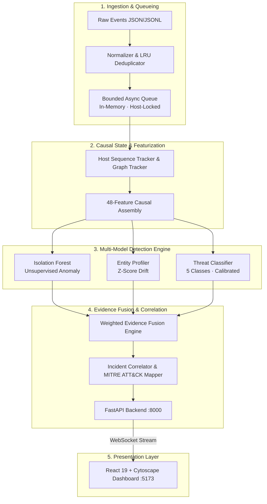

<div align="center">

# 🛡️ AEGIS-ML

### Multi-Layer Cyber Threat Detection & Incident Correlation Engine

**Release Candidate 1 (`v1.0.0-rc.1`)**

An asynchronous cyber defense platform that ingests heterogeneous security telemetry, extracts an immutable 48-dimensional causal feature contract, fuses supervised threat classification with unsupervised anomaly detection, and correlates multi-stage attacks along the **MITRE ATT&CK** kill chain.

[](https://python.org)
[](https://fastapi.tiangolo.com)
[](https://react.dev)
[](https://vitejs.dev)
[](https://scikit-learn.org)
[](tests/)
[](CHANGELOG.md)

[Quick Start](#-quick-start) · [Architecture](#-architecture-overview) · [Detection Pipeline](#-detection-pipeline) · [Evaluation](#-evaluation-methodology--results) · [Benchmarks](#-performance-benchmarks) · [Architecture Doc](docs/ARCHITECTURE.md) · [Model Card](docs/MODEL_CARD.md) · [Demo Guide](docs/DEMO_GUIDE.md)

</div>

---

## 📌 Project Status

**Current Stage: Release Candidate 1 (`v1.0.0-rc.1`)**  
AEGIS-ML has concluded its 30-phase architectural hardening and validation sequence. The codebase is fully verified across unit, integration, and security test suites (324/324 passing tests). It is prepared for controlled staging, lab replay, and portfolio evaluation.

> [!NOTE]
> AEGIS-ML is a research-grade threat detection engine. All evaluations were conducted on scenario-grouped synthetic benchmarks. External dataset evaluation on CIC-IDS2017 remains strictly **BLOCKED** due to missing endpoint telemetry and schema incompatibility in public releases.

---

## 🌐 Problem Statement

Enterprise security operations centers (SOCs) face two chronic failure modes:
1. **Single-Signal Blind Spots:** Network-only signatures fail to detect host-level privilege escalation, while host-only EDR tools miss lateral network traversal and external C2 tunneling.
2. **Alert Fatigue & Disconnection:** Independent alert streams inundate analysts with disconnected notifications, obscuring multi-stage campaigns.

AEGIS-ML solves this by unifying **network flows, endpoint process executions, and application authentication logs** into a single normalized event stream, scoring each event across four independent models, and correlating alerts into unified incident timelines mapped to the **MITRE ATT&CK** kill chain.

---

## ⚡ Key Capabilities

- **Streaming Telemetry Normalization:** Enforces a strict `UnifiedEvent` schema with monotonic UTC timestamp normalization and IP/port validation across network, endpoint, and application layers.
- **Immutable 48-Feature Causal Assembly:** Extracts 48 causal features combining behavioral baselines, relational graph context, missingness flags, and per-host sequence transitions without future temporal leakage.
- **Hybrid Multi-Model Inference:**
  - *Supervised Classification:* Balanced Random Forest classifying 5 canonical threat categories.
  - *Isotonic Probability Calibration:* Re-maps ensemble leaf outputs into verified posterior probabilities $\hat{P}(Y=c|X)$.
  - *Unsupervised Anomaly Detection:* Isolation Forest detecting zero-day and out-of-profile outliers.
  - *Behavioral Deviation Profiling:* Z-score entity deviation for hosts and service accounts.
  - *Temporal Graph Analysis:* NetworkX entity-edge tracking identifying multi-hop lateral movements.
- **Weighted Evidence Fusion:** Synthesizes classifier confidence, anomaly scores, baseline drift, and topology metrics into a single calibrated severity verdict.
- **Deterministic Incident Correlation:** Clusters alerts sharing victim entities, pivot credentials, or infrastructure within rolling time windows into strongly-typed incidents.
- **Bounded Async Worker Queue:** Non-blocking ingestion queue with per-host serialization locks, exponential backoff retries, and credential-sanitized dead-letter storage.
- **Real-Time Interactive SOC Dashboard:** React 19 + Cytoscape + Vite UI connected via WebSocket (`/ws/live`) with dynamic topology visualization.

---

## 🏗️ Architecture Overview



*For complete architectural specifications, see [docs/ARCHITECTURE.md](docs/ARCHITECTURE.md).*

---

## 🔬 Detection Pipeline

### 1. 48-Dimensional Causal Feature Schema
The pipeline enforces an immutable 48-feature contract (`PHASE22_BASELINE_FEATURE_NAMES`):
- **Base Behavioral & Telemetry (15):** Byte volumes, packet ratios, connection duration, port risk scores, failed auth rates, protocol encodings, entity deviation score, Isolation Forest baseline.
- **Relational Graph Topology (6):** Source out-degree, destination in-degree, bipartite ratio, multi-hop indicator, graph density, clustering coefficient.
- **Context & Privilege Flags (10):** Layer indicators, privilege flags, service account flags, business hours indicator, cross-subnet routing flag.
- **Explicit Missingness Indicators (5):** Binary indicators for missing parent process, missing user ID, missing payload hash, missing port, missing session token (prevents zero-imputation bias).
- **Host Sequence Transitions (12):** Rolling event rates, burst ratio, sequence transitions (auth $\rightarrow$ exec $\rightarrow$ network egress), time-delta variances.

All aggregations operate strictly backward in time with zero forward-looking data leakage.

### 2. Threat Classes & MITRE ATT&CK Mapping
| Canonical Class | Description | Kill-Chain Stage |
|:---|:---|:---|
| `benign` | Normal enterprise operations, authorized traffic, standard polling | N/A |
| `brute_force` | Credential stuffing, repeated auth failures, password spraying | Weaponize / Delivery |
| `lateral_movement` | Internal reconnaissance, PsExec execution, SMB credential re-use | Install |
| `c2_beaconing` | Periodic bot heartbeats, external command & control tunneling | Command & Control |
| `data_exfiltration` | High-volume outbound transfer, staging archive exfiltration | Exfiltrate |

---

## ⚙️ Streaming Ingestion & Queue Architecture

The asynchronous ingestion engine decouples high-throughput ingestion from ML detection:
- **Bounded In-Memory Queue:** Implemented via `asyncio.Queue` with configurable capacity (`AEGIS_QUEUE_MAX_SIZE=1000`).
- **Host-Partitioned Concurrency:** Concurrency workers acquire per-host `asyncio.Lock` partitions, ensuring out-of-order dequeuing never corrupts per-host sequence state.
- **Backpressure Enforcement:** Saturated queues immediately reject excess events under backpressure policies (`REJECT` via HTTP 429).
- **Exact Event Accounting:** Reconciles 100% of submitted events with mathematical verification:
  $$\text{submitted\_events} = \text{completed} + \text{failed} + \text{duplicates} + \text{rejected} + \text{queued} + \text{processing}$$
- **Process-Crash Limitation:** The queue is held in application memory. Unhandled process termination or container crashes will lose uncompleted queue contents; durable zero-loss operation across crashes requires an external message broker (Kafka/RabbitMQ).

---

## 🧪 Evaluation Methodology & Results

### Rigorous Evaluation Standards
- **Scenario-Grouped Partitioning:** Partitioned by distinct attack scenarios (`scenario_id`) via `StratifiedGroupKFold`.
  - **Train Split:** 81 scenarios (3,969 events)
  - **Validation Split:** 11 scenarios (663 events) — used exclusively for calibration fitting
  - **Test Split:** 24 scenarios (1,085 events) — strictly held-out
- **Zero Train/Test Overlap:** Proven **0.00%** scenario leakage.
- **Preprocessor Fitting Boundary:** Feature scalers, baseline profilers, and isolation forests were fitted strictly on the training partition.

### Verified Test-Set Results (`docs/MODEL_CARD.md`)
Evaluated on the 1,085 test events from unseen scenarios:

| Metric | Score | Detail |
|:---|:---:|:---|
| **Overall Accuracy** | **99.45%** | 1,079 of 1,085 test events correctly classified |
| **Balanced Accuracy** | **98.73%** | Mean recall across all 5 classes |
| **Macro-F1 Score** | **99.09%** | Unweighted F1 across classes |
| **Benign False Alarm Rate (FPR)** | **0.15%** | Exactly 1 false positive out of 679 benign events |
| **Attack Detection Recall** | **99.01%** | 402 of 406 attack events successfully detected |
| **Calibrated Multi-Class Log-Loss** | **0.2132** | Isotonic probability calibration |
| **Binary Brier Score** | **0.0060** | Probability mean squared error |

*Bit-level reproducibility is verified via `python backend/evaluation/evaluation_reproducibility_audit.py`.*

---

## 📊 Performance Benchmarks

Measured under sustained load benchmarking (`backend/evaluation/sustained_load_test.py`):

| Workload Tier | Submitted | Completed | In-Queue Dup | Rejected | Detection Throughput | End-to-End Latency ($p_{50}$) | Unexplained Loss |
|:---|:---:|:---:|:---:|:---:|:---:|:---:|:---:|
| **100 events** | 108 | 108 | 0 | 0 | **72.6 eps** | **734 ms** | **0** |
| **250 events** | 271 | 268 | 3 | 0 | **71.6 eps** | **1,483 ms** | **0** |
| **500 events** | 542 | 537 | 5 | 0 | **71.0 eps** | **2,867 ms** | **0** |
| **1,000 events** | 1,084 | 749 | 7 | 328 | **67.8 eps** | **4,645 ms** | **0** |

- **Single-Event Inference Latency:** $0.21\text{ ms}$ (pure classifier inference).
- **Micro-Batched Inference Latency:** $0.03\text{ ms/event}$ at batch size 32.
- **Raw Ingestion Throughput:** $>5,000\text{ events/sec}$ (admission and queueing without synchronous inference).
- **Completed Detection Throughput:** $\sim 70\text{ events/sec}$ (end-to-end extraction, model scoring, fusion, and WebSocket broadcast).

---

## 🚀 Quick Start

### 1. Prerequisites
- Python 3.10+
- Node.js 18+ & npm
- Git

### 2. Setup Environment
```bash
git clone https://github.com/akashcodes23/AEGIS-ML.git
cd AEGIS-ML

# Python environment
python3 -m venv .venv
source .venv/bin/activate
pip install -r backend/requirements.txt

# Frontend dependencies
npm --prefix frontend install

# Environment configuration
cp .env.example .env
```

### 3. Run Backend & Frontend
**Terminal 1 — Backend:**
```bash
uvicorn backend.api.main:app --host 0.0.0.0 --port 8000 --reload
```

**Terminal 2 — Frontend:**
```bash
cd frontend && npm run dev
```

Visit the dashboard at `http://localhost:5173`. Backend API docs are at `http://localhost:8000/docs`.

*For an interactive walk-through with curl examples, see [docs/DEMO_GUIDE.md](docs/DEMO_GUIDE.md).*

---

## 🧪 Reproducing Tests & Evaluations

Run the full verification suite:

```bash
# 1. Full Pytest Suite (324 tests across all phases)
python -m pytest tests/ -v

# 2. Bit-Level Evaluation Reproducibility Audit
python backend/evaluation/evaluation_reproducibility_audit.py

# 3. Detection Quality & Error Breakdown
python backend/evaluation/detection_quality_evaluation.py

# 4. Sustained Load & Queue Reconciliation Benchmark
python backend/evaluation/sustained_load_test.py

# 5. Frontend Production Bundle Build
npm --prefix frontend run build
```

---

## 🔒 Security Architecture

- **Fail-Closed Administrative Controls:** Sensitive endpoints (`/api/model/reload`, `/api/ingest/reset`, `/api/ingest/replay`, `/api/ingest/queue/dead-letter`) require `AEGIS_ADMIN_KEY` in staging/production; requests fail-closed with HTTP 503 if unconfigured.
- **Dual-Header Authentication Parity:** Accepts both `X-AEGIS-Admin-Key` and `Authorization: Bearer <key>`. Conflicting or invalid keys return HTTP 403.
- **Path Traversal Protection:** Artifact filenames are sanitized, preventing directory traversal attacks.
- **Dead-Letter Sanitization:** Authorization headers, tokens, passwords, and private keys are recursively scrubbed prior to dead-letter persistence.

---

## ⚠️ Known Limitations & Honest Scope

1. **In-Memory Queue Crash Volatility:** The async queue is in-memory (`asyncio.Queue`). Abnormal process termination will drop in-flight queue items. Zero-loss durability across power failures requires an external message broker (Kafka/RabbitMQ).
2. **Benchmark Scope vs. Enterprise Generalization:** High reported accuracy derives from scenario-grouped synthetic benchmarks. Real-world corporate deployments encounter novel zero-day distributions and concept drift requiring continuous baseline retraining.
3. **Status of External Datasets (CIC-IDS2017 is BLOCKED):** Public CIC-IDS2017 releases lack endpoint execution context, user identities, and timestamps necessary for the 48-feature causal schema. Evaluation remains strictly BLOCKED until verified compatible datasets exist.
4. **Relational Analysis:** Graph metrics are computed deterministically via NetworkX rather than an end-to-end differentiable Temporal Graph Neural Network (T-GNN).
5. **No Kernel-Level Enforcement:** AEGIS-ML is a detection, scoring, and correlation system; it does not deploy kernel-mode EDR agents or automated firewall configuration drivers.

---

## 🗺️ Roadmap

- [ ] **External Broker Adapters:** Apache Kafka and RabbitMQ connectors for crash-durable event streaming.
- [ ] **Temporal Graph Neural Network (T-GNN):** PyTorch-based inductive graph neural network for relational anomaly embedding.
- [ ] **Continuous Online Baseline Adaptation:** Streaming drift detection (ADWIN/River) to adapt entity profiles to gradual seasonal drift.
- [ ] **Analyst Feedback Recalibration:** Active learning workflow incorporating analyst alert dispositions to update calibration curves.

---

## 🛠️ Technology Stack

| Layer | Technology |
|:---|:---|
| **API & Ingestion** | FastAPI · Uvicorn · WebSockets · Pydantic v2 · asyncio |
| **Supervised Machine Learning** | scikit-learn (Balanced Random Forest) · Isotonic Regression |
| **Anomaly Detection** | scikit-learn (Isolation Forest) · SciPy (Z-score profiling) |
| **Graph Intelligence** | NetworkX (Causal entity-edge tracking) |
| **Resampling & Pipeline** | imbalanced-learn (`ImbPipeline` + SMOTE inside folds) |
| **Frontend Dashboard** | React 19 · Vite · Cytoscape.js · Recharts · Lucide Icons |
| **Testing & Verification** | pytest · pytest-asyncio · httpx TestClient |

---

## 📄 License & Release Metadata

- **Release:** `v1.0.0-rc.1` (Release Candidate 1)
- **Model Hash (SHA-256):** `98e926edc4dc53e3e34d48c78aa0390565c70029325bea896e0ab631e757ce71`
- **Dataset Hash (SHA-256):** `1a8967f3253bb6dfdd19d278a3f1f486759305fa447c5a84a4daafbb892ce352`
- **License:** [Apache 2.0](LICENSE)

Built by [@akashcodes23](https://github.com/akashcodes23).
