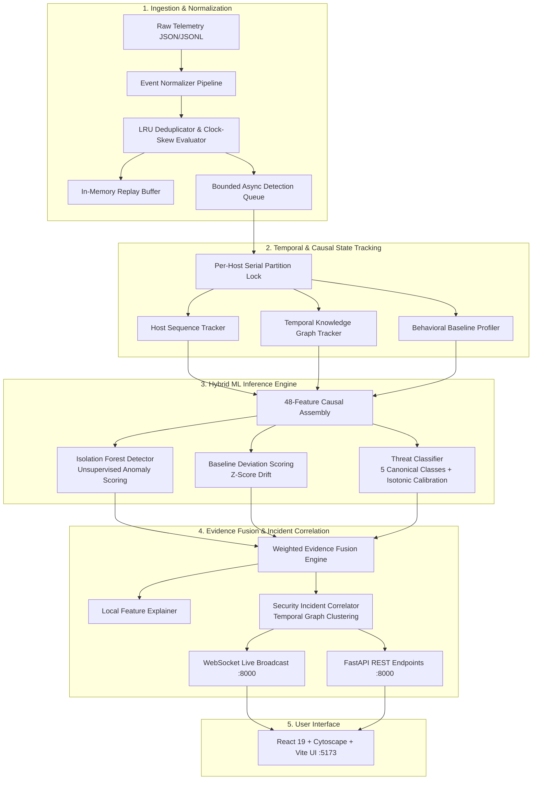
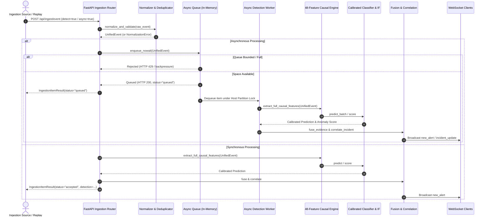

# AEGIS-ML System Architecture Specification

## 1. Overview & System Boundaries

AEGIS-ML is an asynchronous, multi-layered cyber threat intelligence and anomaly detection engine. It processes heterogeneous security telemetry (network flows, endpoint process logs, authentication events, application requests) through a four-stage defense pipeline:
1. **Streaming Ingestion & Normalization:** Validates schemas, enforces UTC timestamps, sanitizes fields, deduplicates via LRU fingerprints, and manages backpressure.
2. **Causal Feature Extraction & State Tracking:** Extracts an immutable 48-dimensional causal feature vector combining behavioral baselines, per-host sequences, and graph topology.
3. **Hybrid Detection Engine:** Evaluates events concurrently across unsupervised anomaly detection (Isolation Forest), per-entity deviation profilers, and supervised threat classification (Calibrated Random Forest).
4. **Evidence Fusion & Incident Correlation:** Combines multi-source evidence into a unified calibrated confidence score, attaches MITRE ATT&CK kill-chain stages, and correlates alerts across entities into ongoing security incidents.

---

## 2. Component Breakdown

### 2.1 Ingestion & Normalization Layer
- **Unified Event Schema (`backend/core/schemas.py`):** Normalized representation ensuring uniform typing across network, endpoint, and application layers (`event_id`, `timestamp`, `layer`, `src_ip`, `dst_ip`, `src_port`, `dst_port`, `protocol`, `action`, `process_name`, `user_id`, `host_id`).
- **Normalizer Pipeline (`backend/ingestion/event_normalizer.py`):**
  - Strict validation of required schema fields, IP formatting, and port ranges ($0 \le \text{port} \le 65535$).
  - Monotonic timestamp parsing converting mixed inputs into UTC ISO-8601 datetimes.
  - Flagging of late-arriving events ($>300\text{s}$ behind high watermark) and future clock skew ($>60\text{s}$ ahead).
- **Idempotency & Deduplication (`backend/ingestion/streaming_ingestion.py`):**
  - High-capacity LRU cache (`max_capacity=100,000`).
  - Dual-key deduplication: explicit `event_id` and deterministic payload SHA-256 fingerprint.

### 2.2 Asynchronous Worker & Queue Subsystem
- **Async Detection Queue (`backend/ingestion/async_queue.py`):**
  - In-memory bounded queue (`asyncio.Queue`) with configurable capacity (`AEGIS_QUEUE_MAX_SIZE`, default 1,000).
  - **Backpressure Policies:** `REJECT` (HTTP 429/rejected result immediately when saturated) or `BLOCK` (awaits available slot with configurable timeout).
  - **Host-Partition Ordering:** Concurrency workers acquire per-host `asyncio.Lock` partitions ensuring that out-of-order execution never corrupts per-host temporal state.
  - **Error Classification & Retries:** Differentiates `TransientDetectionError` (retried with exponential backoff up to 3 attempts) from `PermanentDetectionError` (routed immediately to Dead-Letter Queue).
  - **Dead-Letter Storage:** Captures failed events with root cause metadata, failure timestamp, retry count, and **strictly sanitized/redacted credential payloads**.
  - **Process Crash Volatility:** The queue is in-memory; accepted events in queue memory will not survive an ungraceful process termination.

### 2.3 Feature Engineering Contract (48 Causal Dimensions)
The production classifier requires an immutable 48-feature schema (`PHASE22_BASELINE_FEATURE_NAMES`):
1. **Base Features (15):** Byte volumes, packet counts, duration, port risk score, failed authentication rate, protocol encodings, entity deviation scores, Isolation Forest baseline score.
2. **Relational Graph Features (6):** Source out-degree, destination in-degree, bipartite connection ratio, multi-hop connection flags, graph centrality metrics.
3. **Telemetry Context Features (10):** Layer type indicators, internal/external IP routing flags, privilege level flags, service account flags, business hours indicator.
4. **Missingness Indicators (5):** Explicit binary indicators tracking missing parent process, missing user ID, missing payload hash, missing port, missing session token (protecting against zero-imputation bias).
5. **Host Sequence Features (12):** Rolling event rates, burst ratio, sequence transitions (auth $\rightarrow$ process spawn $\rightarrow$ network egress), time-delta variances.

All window aggregations look strictly backward in time; zero future information is accessible during extraction.

### 2.4 Hybrid Detection & Model Lifecycles
- **Threat Classifier (`backend/detection/threat_classifier.py`):**
  - Balanced Random Forest trained across 5 canonical classes: `benign`, `brute_force`, `c2_beaconing`, `data_exfiltration`, `lateral_movement`.
  - Isotonic Probability Calibration: Post-transforms raw RF leaf fractions into well-calibrated posterior probabilities $\hat{P}(Y=c|X)$.
- **Isolation Forest (`backend/detection/isolation_forest.py`):**
  - Unsupervised outlier scoring detecting structural anomalies independent of attack labels.
- **Behavioral Profiler (`backend/detection/baseline_profiler.py`):**
  - Entity-level baseline models tracking typical traffic volumes, access hours, and communication peers per host and service account.

### 2.5 Evidence Fusion & Explainability
- **Fusion Engine (`backend/detection/evidence_fusion.py`):**
  - Combines calibrated classifier confidence, anomaly scores, baseline deviation, and graph density into a single consensus severity (`low`, `medium`, `high`, `critical`).
- **Local Explainer (`backend/explainability/feature_importance.py`):**
  - Extracts the top contributing features driving each threat classification and contrasts them against entity baseline norms.

### 2.6 Incident Correlation Engine
- **Correlation Logic (`backend/correlation/incident_correlator.py`):**
  - Graph-based clustering: Alerts involving common source entities, victim hosts, or lateral pivot credentials within a rolling time window are coalesced into a single `Incident`.
  - MITRE ATT&CK Kill-Chain Tracking: Tracks adversary progression from *Weaponization/Delivery* through *Command & Control* and *Exfiltration*.

---

## 3. End-to-End Processing Sequence

---

## 4. Operational Boundaries and Limitations

1. **In-Memory Volatility:**
   The queue and state trackers are maintained in Python application memory. If the process is halted via `SIGKILL`, crash, or container redeploy, in-flight queue items and unsaved replay buffers are dropped. Graceful `SIGINT`/`SIGTERM` drains the queue up to shutdown timeouts.
2. **No Kernel Enforcement:**
   AEGIS-ML produces telemetry detections, confidence metrics, and containment recommendations. It does not interface directly with Linux `iptables`, Windows Filtering Platform, or kernel-level EDR drivers.
3. **Synthetic Calibration Boundaries:**
   Evaluation metrics and probability calibrations reflect held-out scenario-grouped synthetic benchmarks. Concept drift in real-world corporate IT environments will necessitate continuous re-profiling.
4. **Relational Topology vs Differentiable GNN:**
   Graph metrics are extracted using NetworkX graph algorithms over sliding time windows rather than an end-to-end differentiable graph neural network.
