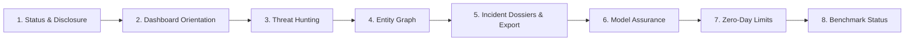

# AEGIS-ML v1.0.0: Operator & Technical Reviewer Demonstration Guide

This guide provides a structured, 5–8 minute technical demonstration walkthrough for evaluating the AEGIS-ML Cyber Threat Intelligence and Model Assurance platform.

---

## 0. Foundational Disclosures & Epistemic Scope

Before evaluating the interface, reviewers must note three distinct data tiers utilized across the platform:

1. **Real Operational Telemetry**: Live incoming network transactions and endpoint events ingested via the FastAPI backend (`http://localhost:8000/api/ingest/event`) or active WebSocket streams (`ws://localhost:8000/ws/live`).
2. **Synthetic Demonstrations & Replay Fixtures**: Controlled, deterministic synthetic network flows and host events replayed from `behavioral_diversity_labeled.jsonl`. Synthetic demonstrations validate causal feature extraction, correlation heuristics, and interface responsiveness under known conditions.
3. **Frozen Offline Evaluation Results**: Pre-registered empirical measurements evaluated on held-out scenario partitions (`docs/evaluation/results.json` and `docs/model-card.md`).

> [!IMPORTANT]
> **Synthetic Evaluation Scope**: High performance metrics on synthetic benchmarks demonstrate architectural correctness, feature relevance, and calibration alignment under controlled assumptions. They do **not** constitute empirical proof of equal efficacy against novel, adaptive real-world enterprise adversaries.

---

## 1. Prerequisites & Environment Setup

### 1.1 Requirements
- **Python**: 3.10, 3.11, or 3.12
- **Node.js**: 18.x, 20.x, or 22.x
- **Browsers**: Chromium, Firefox, or Safari (Desktop: $\ge 1280\text{px}$, Mobile: $\ge 390\text{px}$)

### 1.2 Starting the Platform Locally

**Terminal 1 — Backend API Server**:
```bash
cd /Users/akashgpatil/major_project/AEGIS-ML
source .venv/bin/activate  # or python3 -m venv .venv && source .venv/bin/activate
uvicorn backend.api.main:app --host 0.0.0.0 --port 8000
```
*Health verification:* `curl -s http://localhost:8000/api/health | jq .`

**Terminal 2 — Frontend Application**:
```bash
cd /Users/akashgpatil/major_project/AEGIS-ML/frontend
npm run preview -- --port 4173 --host 127.0.0.1
# Or for local development with HMR:
# npm run dev
```
*Dashboard location:* `http://localhost:4173/` (or `http://localhost:5173/` if using dev server)

---

## 2. Structured 5–8 Minute Demonstration Walkthrough



---

### Step 1: System Status & Data-Mode Disclosure
- **Starting Route**: `/`
- **Required Application State**: Backend running or in standby; frontend loaded in browser.
- **User Action**:
  1. Inspect the top application header and connection status pills in the top-left bar.
  2. Inspect the amber disclosure ribbon affixed above the main view container.
- **Expected Visible Behavior**:
  - Connection pill bar indicates genuine state:
    - `WS: Stream Live` (green pulse) when connected, or `WS: Disconnected` / `Reconnecting` when offline.
    - `API: Healthy` (green dot) or `API: Offline` (red dot).
  - Amber synthetic disclosure ribbon states:
    `"Controlled Synthetic Demonstration Mode: Detections and replay telemetry derive from behavioral_diversity_labeled.jsonl. Real-world adversary environments may differ."`
- **Evidence to Inspect**:
  - `frontend/src/components/Navigation/StatusArea.jsx`
  - `frontend/src/components/Common/SyntheticDemoRibbon.jsx`
- **Failure / Unavailable-State Behavior**:
  If the backend is terminated, the API pill immediately turns red (`API: Offline`) and the WebSocket pill displays retry countdowns with exponential backoff. The synthetic disclosure ribbon is permanent and non-dismissible.

---

### Step 2: Dashboard Orientation & Live Stream Control
- **Starting Route**: `/`
- **Required Application State**: Simulation runner idle or active.
- **User Action**:
  1. Review the four primary posture scorecards: *Network Pulse (eps)*, *Events Processed*, *Correlated Incidents*, *False Positives (Unlabelled)*.
  2. Inspect the active dataset panel (`DatasetPanel`).
  3. Click `"Start Analysis"` to initiate streaming replay of `behavioral_diversity_labeled.jsonl`.
  4. Inspect the interactive *Temporal Scrubber* to view historical detection timelines.
- **Expected Visible Behavior**:
  - Live alerts stream into the *Alert Feed* with calculated severity badges.
  - Active network topology renders in the *Attack Graph* canvas with directed edges.
  - Scrubber scrub head allows scrubbing backwards in time to reconstruct earlier network states.
- **Evidence to Inspect**:
  - `frontend/src/components/Dashboard/Dashboard.jsx`
  - `frontend/src/components/Dashboard/AlertFeed.jsx`
  - `frontend/src/components/Common/TemporalScrubber.jsx`
- **Failure / Unavailable-State Behavior**:
  If analysis start fails (e.g. backend offline), a critical error banner appears with the exact HTTP error code and a dismiss control. If telemetry lacks timestamps, the scrubber excludes them from temporal slicing and reports the excluded count.

---

### Step 3: Threat Hunting Investigation & Calibrated Confidence
- **Starting Route**: `/threat-hunting` (or click "Threat Hunting" dock item / press `⌘K` → type "hunting")
- **Required Application State**: Alerts populated from active stream or loaded fixtures.
- **User Action**:
  1. Filter alerts by threat type (`data_exfiltration`, `lateral_movement`, `brute_force`, `c2_beaconing`).
  2. Filter alerts by severity (`critical`, `high`, `medium`, `low`).
  3. Select any alert row to expand the *Evidence Provenance Trail*.
  4. Inspect the calibrated confidence score, raw vs. calibrated probability delta, and top causal feature contributions.
- **Expected Visible Behavior**:
  - Alert table updates instantly and deterministically.
  - Evidence trail displays the MITRE technique name, kill-chain stage, and explicitly denotes whether confidence is calibrated via `CalibratedClassifierCV` (isotonic regression) or uncalibrated.
- **Evidence to Inspect**:
  - `frontend/src/components/ThreatHunting/ThreatHunting.jsx`
  - `frontend/src/components/ThreatHunting/EvidenceTrail.jsx`
  - `frontend/src/utils/evidence.js`
- **Failure / Unavailable-State Behavior**:
  If no alerts match the active filter criteria, a descriptive empty state renders: *"No threat detections match the selected hunting criteria."* If feature importance is model-level rather than local SHAP values, it is explicitly annotated as *Partial / Model-Level*.

---

### Step 4: Entity Graph Exploration & Kill-Chain Depth
- **Starting Route**: `/entity-graph` (or click "Entity Graph" dock item / press `⌘K` → type "graph")
- **Required Application State**: Network nodes and attack edges loaded.
- **User Action**:
  1. Pan and zoom across the Cytoscape graph canvas.
  2. Click a compromised host entity (e.g. `10.0.0.45`) to focus its blast radius.
  3. Observe the node z-plane and visual halo reflecting its MITRE kill-chain progression stage.
  4. Inspect the entity detail slide-out drawer on the right.
- **Expected Visible Behavior**:
  - Compromised nodes display distinct high-severity styling; benign internal servers maintain neutral low-contrast styling.
  - Solid edges represent directly observed communication flows; dashed edges indicate inferred pivot links.
- **Evidence to Inspect**:
  - `frontend/src/components/Graph/EntityGraphView.jsx`
  - `frontend/src/utils/depth.js`
- **Failure / Unavailable-State Behavior**:
  If graph data is empty, the canvas displays an informative empty state prompting the operator to start analysis. Nodes without verified kill-chain evidence default to `"Unknown"` depth without guessing.

---

### Step 5: Incident Dossiers & Cryptographic Briefing Export
- **Starting Route**: `/reports` (default sub-tab: "Operational Incident Dossiers")
- **Required Application State**: Correlated incidents formed by backend sliding window.
- **User Action**:
  1. Review posture scorecards and the *Empirical Attack Vector Distribution* table.
  2. Inspect the *Correlated Campaign Incidents* dossier cards with recommended playbooks.
  3. Click `"Export Audit Report (JSON)"` and `"Export Alert Log (CSV)"`.
  4. Click `"Executive Briefing (Print/PDF)"` to generate a briefing modal.
  5. Inspect the SHA-256 cryptographic integrity hash displayed in the modal header.
- **Expected Visible Behavior**:
  - JSON audit report downloads containing system state, model readiness, and incident links.
  - CSV log downloads formatted RFC 4180 alert rows.
  - Executive briefing modal opens with printable executive summary, timeline reconstruction, and SHA-256 evidence fingerprint.
- **Evidence to Inspect**:
  - `frontend/src/components/Reports/Reports.jsx`
  - `frontend/src/components/Reports/BriefingModal.jsx`
  - `frontend/src/utils/briefing.js`
- **Failure / Unavailable-State Behavior**:
  If `window.crypto.subtle` is unavailable (e.g. non-secure HTTP context), the briefing engine falls back to a deterministic SHA-256 implementation with an explicit disclosure footnote.

---

### Step 6: Model Assurance Metrics & Uncertainty Intervals
- **Starting Route**: `/model-assurance` or `/reports#model-assurance`
- **Required Application State**: Static versioned Stage 6 evaluation artifacts.
- **User Action**:
  1. Navigate to Model Assurance view (via sub-tab, URL hash, or ⌘K shortcut).
  2. Inspect the 4 headline metric cards and their 95% bootstrap confidence intervals:
     - **Macro F1**: `0.9866` (95% CI: `[0.7803, 0.9987]`, Mean: `0.9674`, Std: `±0.0606`)
     - **Benign False-Positive Rate**: `0.0024` (95% CI: `[0.0000, 0.0097]`, 1 FP / 419 flows, `2,386.63` alerts / 1M flows)
     - **Expected Calibration Error (ECE)**: `0.0011` (95% CI: `[0.0003, 0.0120]`, `↓ 0.1130` reduction from uncalibrated 0.1141)
     - **Multi-Class Brier Score**: `0.0109` (95% CI: `[0.0028, 0.0270]`, `↓ 0.1035` reduction from uncalibrated 0.1144)
  3. Inspect the *Comparative Baselines* table (Majority Dummy, L2 Logistic Regression, Untuned RF, Calibrated RF).
  4. Inspect the *Scenario-Grouped Partitioning* cards: 4,155 Train (80 scenarios), 676 Val (17 scenarios), 886 Test (19 scenarios), with `0.0%` scenario overlap.
  5. Click `"Export Evaluation Protocol (JSON)"` to download the machine-readable evaluation summary.
- **Expected Visible Behavior**:
  - Dark-mode scorecards render with monospace numbers and clear uncertainty intervals.
  - ECE is strictly labeled as calibration error (confidence vs. accuracy gap), never as accuracy.
  - Confidence is explicitly defined as empirical posterior probability.
- **Evidence to Inspect**:
  - `frontend/src/components/Reports/ModelAssuranceView.jsx`
  - `frontend/src/data/modelAssuranceData.js`
  - `docs/evaluation/results.json`
- **Failure / Unavailable-State Behavior**:
  If any evaluation field is undefined or malformed, the component safely renders `Unavailable` without crashing and without injecting fictitious fallback numbers.

---

### Step 7: Zero-Day Attack Generalization Limitations
- **Starting Route**: `/model-assurance` (Section 3: "Zero-Day Attack Generalization & Escape Rates")
- **Required Application State**: Stage 6 leave-one-attack-type-out stress test results.
- **User Action**:
  Inspect the empirical escape rate table when testing against novel, unobserved attack categories:
  - **Data Exfiltration**: 147 test flows → **100.0%** escape to benign
  - **Lateral Movement**: 35 test flows → **94.3%** escape to benign (33 to benign, 2 to C2)
  - **Brute Force**: 238 test flows → **92.4%** escape to benign (220 to benign, 18 to C2)
  - **C2 Beaconing**: 47 test flows → **44.7%** escape to benign (profiler anomaly layer achieves 38.3% recall)
- **Expected Visible Behavior**:
  - Escapes are badged in critical severity tokens and labeled as a *"Known Architectural Limitation"*.
  - Accompanying architectural mitigation notes explain that supervised classification alone is fundamentally blind to unobserved zero-day attack patterns, providing the empirical justification for AEGIS's multi-layered defense (Supervised + Anomaly Profiling + Temporal Correlation).
- **Evidence to Inspect**:
  - `docs/evaluation/RESULTS.md`
  - `docs/model-card.md`
- **Failure / Unavailable-State Behavior**:
  The platform reports exact measured escape rates honestly; zero-day capabilities are never overstated.

---

### Step 8: External Benchmark Status (CIC-IDS2017)
- **Starting Route**: `/model-assurance` (Section 5: "Artifact Provenance & External Benchmark Status")
- **Required Application State**: External benchmark audit metadata.
- **User Action**:
  Inspect the CIC-IDS2017 Benchmark Status card.
- **Expected Visible Behavior**:
  - Status is clearly displayed as `BLOCKED_AWAITING_LOCAL_COPY`.
  - Explanation: Interactive click-through registration required by University of New Brunswick; local raw dataset absent from offline evaluation environment; 35.4% feature schema discrepancy for endpoint process context.
  - Explicit confirmation: `Fabricated Numbers: false`.
- **Evidence to Inspect**:
  - `docs/evaluation.md`
  - `docs/evaluation/results.json`
- **Failure / Unavailable-State Behavior**:
  The platform refuses to display estimated or unvalidated external benchmark figures.

---

## 3. Quick Reference: Keyboard Shortcuts

| Shortcut | Action | Destination |
| :--- | :--- | :--- |
| `⌘K` or `Ctrl+K` | Open Command Palette | Global overlay |
| Type `"assurance"` + `Enter` | Jump to Model Assurance | `/reports#model-assurance` |
| Type `"hunting"` + `Enter` | Jump to Threat Hunting | `/threat-hunting` |
| Type `"graph"` + `Enter` | Jump to Entity Graph | `/entity-graph` |
| Type `"fx"` + `Enter` | Toggle Reduced Visual Effects | Atmosphere toggle |
| `Escape` | Dismiss Modals / Command Palette | Closes active modal |

---

## 4. Verification & Testing Commands

To reproduce the verification results reported in this release:

```bash
# 1. Run all frontend unit and integration tests (76 tests)
node --test frontend/src/**/*.test.js

# 2. Run frontend linter
npm --prefix frontend run lint

# 3. Run frontend production build
npm --prefix frontend run build

# 4. Run backend evaluation and core logic tests (25 tests)
PYTHONPATH=. pytest tests/test_evaluation_integrity_stage6.py tests/test_threat_classifier.py tests/test_incident_correlator.py
```
