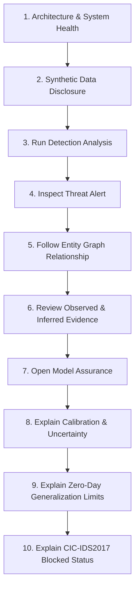

# AEGIS-ML v1.0.0: Operator & Technical Reviewer Demonstration Guide

This guide provides a reproducible, 5–7 minute technical demonstration walkthrough for evaluating the AEGIS-ML Cyber Threat Intelligence, Evidence Integrity, and Model Assurance platform.

---

## 0. Foundational Disclosures & Epistemic Scope

Before evaluating the interface, reviewers must note three distinct data tiers utilized across the platform:

1. **Real Operational Telemetry**: Live incoming network transactions and endpoint events ingested via the FastAPI backend (`http://localhost:8000/api/ingest/event`) or active WebSocket streams (`ws://localhost:8000/ws/live`).
2. **Synthetic Demonstrations & Replay Fixtures**: Controlled, deterministic synthetic network flows and host events replayed from `behavioral_diversity_labeled.jsonl`. Synthetic demonstrations validate causal feature extraction, correlation heuristics, and interface responsiveness under known conditions.
3. **Frozen Offline Evaluation Results**: Pre-registered empirical measurements evaluated on held-out scenario partitions (`docs/evaluation/results.json` and `docs/model-card.md`).

> [!IMPORTANT]
> **Synthetic Evaluation Scope**: High performance metrics on synthetic benchmarks demonstrate architectural correctness, feature relevance, and calibration alignment under controlled assumptions. They do **not** constitute empirical proof of equal efficacy against novel, adaptive real-world enterprise adversaries.

---

## 1. Prerequisites & Environment Setup

### 1.1 Requirements
- **Python**: 3.10, 3.11, or 3.12
- **Node.js**: 18.x, 20.x, or 22.x
- **Browsers**: Chromium, Firefox, or Safari (Desktop: $\ge 1280\text{px}$, Mobile: $\ge 390\text{px}$)

### 1.2 Starting the Platform Locally

**Terminal 1 — Backend API Server**:
```bash
cd /Users/akashgpatil/major_project/AEGIS-ML
source .venv/bin/activate  # or python3 -m venv .venv && source .venv/bin/activate
uvicorn backend.api.main:app --host 0.0.0.0 --port 8000
```
*Health verification:* `curl -s http://localhost:8000/api/health | jq .`

**Terminal 2 — Frontend Application**:
```bash
cd /Users/akashgpatil/major_project/AEGIS-ML/frontend
npm run preview -- --port 4173 --host 127.0.0.1
# Or for local development with HMR:
# npm run dev
```
*Dashboard location:* `http://localhost:4173/` (or `http://localhost:5173/` if using dev server)

---

## 2. Structured 5–7 Minute Demonstration Walkthrough



---

### Step 1: Application Architecture & System Health
- **Starting Route**: `/`
- **Application State**: Backend running or in standby; frontend loaded in browser.
- **Demonstration Action**:
  1. Inspect the connection status indicators in the application header: `API: Healthy` (green indicator) and `WS: Stream Live` (green pulse).
  2. Verify backend health endpoint via terminal:
     ```bash
     curl -s http://localhost:8000/api/health | jq '{loaded: .model_readiness.loaded, features: .model_readiness.feature_count, calibrated: .model_readiness.calibrated}'
     ```
- **Observable Truth**:
  - The backend reports `feature_count: 48` matching the immutable schema contract.
  - Model status reports `calibrated: true` and loaded artifact SHA-256 fingerprint.
  - If the backend is stopped, the indicator immediately turns red (`API: Offline`) without hanging or throwing unhandled JavaScript exceptions.

---

### Step 2: Explicit Synthetic-Data Disclosure
- **Starting Route**: `/`
- **Demonstration Action**:
  1. Inspect the amber warning ribbon permanently anchored across the dashboard header.
  2. Review the active dataset scorecard in `DatasetPanel`.
- **Observable Truth**:
  - The ribbon explicitly states:
    `"Controlled Synthetic Demonstration Mode: Detections and replay telemetry derive from behavioral_diversity_labeled.jsonl. Real-world adversary environments may differ."`
  - The interface forbids claiming that synthetic replay telemetry represents real-world enterprise infrastructure.

---

### Step 3: Running a Detection Analysis
- **Starting Route**: `/`
- **Demonstration Action**:
  1. In `DatasetPanel`, select the synthetic test dataset `behavioral_diversity_labeled.jsonl`.
  2. Click `"Start Analysis"`.
  3. Observe the asynchronous ingestion progress and the Temporal Scrubber.
- **Observable Truth**:
  - Ingestion progress bar advances smoothly as events flow into the detection pipeline.
  - Posture status displays: `"Analyzing Telemetry Stream..."` during ingestion.
  - When ingestion finishes with active threats, the banner explicitly decouples analysis completion from security posture:
    `"Analysis Ingestion Finished — Active Findings ({count} Anomalies Flagged)"` in amber/crimson, rejecting misleading *"Your network looks secure"* banners.

---

### Step 4: Inspecting a Threat Alert
- **Starting Route**: `/` or `/threat-hunting`
- **Demonstration Action**:
  1. In the **Alert Feed**, select a critical detection (e.g., `data_exfiltration` or `lateral_movement`).
  2. Inspect the **Priority Score** scorecard:
     $$\text{Priority} = \min(99, \text{base\_severity} + \text{layer\_bonus} + \text{count\_bonus} + \text{confidence\_factor})$$
  3. Review the confidence badge:
     `Calibrated Confidence: 94.2% (Isotonic calibrated probability)` vs. `Model Consensus: 75% (Uncalibrated Random Forest tree agreement)`.
- **Observable Truth**:
  - Model probability and heuristic composite priority are never conflated into a single uninformative number.
  - Monospace timestamps indicate `(Local)` timezone context.

---

### Step 5: Following an Entity Graph Relationship
- **Starting Route**: `/entity-graph` (or dock icon / `⌘K` → "graph")
- **Demonstration Action**:
  1. Use the keyboard shortcuts on the graph canvas:
     - Press `+` to zoom in, `-` to zoom out, `F` to fit-to-view, and `R` to reset zoom.
     - Press `Esc` to clear selection.
  2. Click on a compromised node (e.g. `10.0.0.50` or `198.51.100.11`):
     - Unrelated nodes and edges dim to 12% opacity (`.faded`).
     - Connected neighbors illuminate with cyan halos (`.highlighted-neighbor`).
  3. Inspect the floating **Node Inspector** panel on the right:
     - Entity label, type (`IP`, `PROCESS`, `USER`), compromised state, in/out degrees.
     - Connected neighbor list with direct `"Focus"` buttons.
  4. Toggle attribute filters:
     - Filter by Node Type: `ALL`, `IP`, `PROCESS`, `USER`.
     - Filter by Provenance: `ALL`, `ANOMALOUS`, `OBSERVED`, `INFERRED`.
- **Observable Truth**:
  - Solid edges represent direct observed telemetry; dashed purple edges denote inferred correlation pivot hypotheses; dashed crimson edges denote anomalous attack flows.
  - Parallel edges between identical endpoints are deduplicated, preventing visual edge density explosion without altering the underlying data model.

---

### Step 6: Reviewing Observed and Inferred Evidence
- **Starting Route**: `/` (Incident Dossier panel) or `/threat-hunting`
- **Demonstration Action**:
  1. In the Incident Dossier, open the **Evidence Provenance Trail** (`EvidenceTrail`).
  2. Review the 5-link provenance filament:
     1. Telemetry Event (`alert.raw_event` or `incident.supporting_events[0]`)
     2. Feature Deviations (`alert.feature_importance`)
     3. Model Score & Calibration (`alert.calibrated_confidence`)
     4. Detection Alert (`alert.alert_id`)
     5. Correlated Incident (`incident.incident_id`)
  3. Review the **Relationship Evidence** list in the incident card.
- **Observable Truth**:
  - Each item is badged with an explicit claim type:
    - `OBSERVED TELEMETRY` (verified packet/host log)
    - `INFERRED HYPOTHESIS` (cross-layer co-occurrence or lateral pivot correlation)
    - `MISSING EVIDENCE` (e.g., `socket_to_pid_binding_absent`, `packet_payload_uninspected`)
  - Duplicate recurring alerts merge into existing relationship links, ensuring evidence totals are never inflated.

---

### Step 7: Opening Model Assurance
- **Starting Route**: `/model-assurance` or `/reports#model-assurance` (or `⌘K` → "assurance")
- **Demonstration Action**:
  1. Open the Model Assurance view.
  2. Review the metadata card:
     - Protocol: `1.0.0-preregistered` (`docs/evaluation.md`)
     - Model Card: `docs/model-card.md`
     - Dataset: `behavioral_diversity_labeled.jsonl` (SHA-256: `1a8967f...`)
     - Scenario Splits: 4,155 Train (80 scenarios), 676 Val (17 scenarios), 886 Test (19 scenarios), with `0.0%` scenario overlap.
- **Observable Truth**:
  - All values match `docs/evaluation/results.json` character-for-character.
  - The interface explicitly reminds the reviewer that results come from controlled synthetic partitions.

---

### Step 8: Explaining Calibration and Uncertainty
- **Starting Route**: `/model-assurance`
- **Demonstration Action**:
  1. Review the headline metric scorecards with 95% bootstrap confidence intervals:
     - **Macro F1**: `0.9866` (95% CI: `[0.7803, 0.9987]`, Mean: `0.9674`)
     - **Benign FPR**: `0.0024` (95% CI: `[0.0000, 0.0097]`, 1 FP / 419 test flows)
     - **Expected Calibration Error (ECE)**: `0.0011` (95% CI: `[0.0003, 0.0120]`, reduced from uncalibrated 0.1141)
     - **Brier Score**: `0.0109` (95% CI: `[0.0028, 0.0270]`, reduced from uncalibrated 0.1144)
  2. Inspect the Reliability Diagram / Calibration Curve table:
     - 10 confidence bins with near-zero calibration error across all ranges.
- **Observable Truth**:
  - ECE is strictly labeled as calibration error (gap between confidence and true empirical accuracy), never as detection accuracy.
  - The 95% bootstrap intervals are displayed prominently to communicate uncertainty honestly.

---

### Step 9: Explaining Zero-Day Generalization Limitations
- **Starting Route**: `/model-assurance` (Section 3: "Zero-Day Attack Generalization & Escape Rates")
- **Demonstration Action**:
  1. Review the leave-one-attack-type-out stress test results against novel, unseen attack categories:
     - **Data Exfiltration**: 147 test flows → **100.0% escape rate to benign**
     - **Lateral Movement**: 35 test flows → **94.3% escape rate to benign**
     - **Brute Force**: 238 test flows → **92.4% escape rate to benign**
     - **C2 Beaconing**: 47 test flows → **44.7% escape rate to benign**
- **Observable Truth**:
  - These severe escapes are badged in critical severity tokens and labeled as a *"Known Architectural Limitation"*.
  - The accompanying text explains that supervised machine learning is blind to novel zero-day features, providing the empirical justification for AEGIS-ML's multi-layered defense (Supervised Classifier + Anomaly Profiler + Temporal Incident Correlator).

---

### Step 10: Explaining Why CIC-IDS2017 Benchmark Remains Blocked
- **Starting Route**: `/model-assurance` (Section 5: "Artifact Provenance & External Benchmark Status")
- **Demonstration Action**:
  1. Inspect the CIC-IDS2017 Benchmark Status card.
- **Observable Truth**:
  - The status is clearly displayed as `BLOCKED_AWAITING_LOCAL_COPY`.
  - Stated rationale:
    1. Interactive click-through registration is required by the University of New Brunswick.
    2. The raw dataset was not present in the offline evaluation environment during Stage 6 execution.
    3. The feature schema has a 35.4% discrepancy (endpoint process lineage context is absent from pure PCAP).
  - Explicit confirmation: `Fabricated Numbers: false`. The platform refuses to invent estimated external numbers.

---

## 3. Keyboard Shortcuts Quick Reference

| Shortcut | Action | Destination |
| :--- | :--- | :--- |
| `⌘K` or `Ctrl+K` | Open Command Palette | Global overlay |
| Type `"assurance"` + `Enter` | Jump to Model Assurance | `/reports#model-assurance` |
| Type `"hunting"` + `Enter` | Jump to Threat Hunting | `/threat-hunting` |
| Type `"graph"` + `Enter` | Jump to Entity Graph | `/entity-graph` |
| Type `"fx"` + `Enter` | Toggle Reduced Visual Effects | Spatial atmosphere |
| `+` or `=` (in graph) | Zoom In | Active Cytoscape canvas |
| `-` or `_` (in graph) | Zoom Out | Active Cytoscape canvas |
| `F` or `0` (in graph) | Fit to View | Active Cytoscape canvas |
| `R` (in graph) | Reset Zoom to 1.0x | Active Cytoscape canvas |
| `Escape` | Dismiss Modals / Clear Graph Selection | Active view / overlay |

---

## 4. Verification & Testing Commands

To reproduce the verification results reported in this release:

```bash
# 1. Run all frontend unit and release validation tests (90 tests)
node --test frontend/src/**/*.test.js

# 2. Run frontend linter (0 errors, 0 warnings)
npm --prefix frontend run lint

# 3. Run frontend production build (clean bundle generation)
npm --prefix frontend run build

# 4. Run targeted backend release and evaluation integrity tests (45 tests)
PYTHONPATH=. pytest tests/test_evaluation_integrity_stage6.py tests/test_threat_classifier.py tests/test_incident_correlator.py tests/test_api_endpoints.py tests/test_production_deployment.py

# 5. Run full backend test suite (346 tests)
PYTHONPATH=. pytest tests/
```
