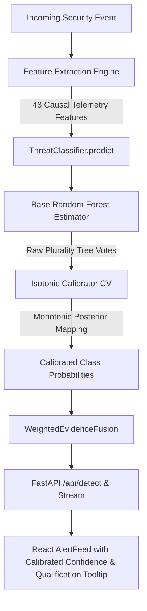

# Phase 23: Calibrated Inference Pipeline and Model Artifact Lifecycle

## 1. Executive Summary and Architecture Overview

Phase 23 operationalizes Phase 22's isotonic calibration into AEGIS-ML's live inference pipeline and establishes a robust, cryptographically verifiable model artifact lifecycle.

Prior to Phase 23, the production threat classifier (`ThreatClassifier`) loaded an unversioned serialized Random Forest artifact (`threat_classifier.pkl`, 15 baseline features) and produced raw ensemble tree-vote agreement proportions. In Phase 22, empirical evaluation demonstrated that raw plurality voting exhibited severe overconfidence on administrative hard negatives (80 false alarms on the 991-sample benchmark partition), whereas Isotonic Calibration mapped these miscalibrated scores down to true empirical risk levels (1 false alarm on seed 42; 1.66% pooled multi-seed false positive rate).

In Phase 23, the full 48-feature causal feature representation (including baseline deviation, temporal graph features, telemetry context, sequence trackers, and causal process attribution) is extracted during online serving, evaluated through the validated base Random Forest, calibrated via scikit-learn `CalibratedClassifierCV` (isotonic regression with `FrozenEstimator`), and fanned out through `WeightedEvidenceFusion` and FastAPI endpoints with explicit confidence qualifications.



---

## 2. Model Artifact Lifecycle Architecture

### 2.1 Artifact Design & Metadata Schema

Artifacts are encapsulated in self-describing, structured dictionaries stored within `data/models/`. The primary production artifact is `calibrated_threat_classifier.pkl` (accompanied by versioned metadata and cryptographic fingerprints).

```python
{
    "schema_version": "1.0.0",
    "model_version": "23.0.0",
    "created_at": "2026-10-10T06:33:04.288289Z",
    "author": "AEGIS-ML Pipeline / Phase 23",
    "dataset_sha256": "1a8967f3253bb6dfdd19d278a3a1f486759305fa447c5a84a4daafbb892ce352",
    "dataset_records": 5717,
    "model": <RandomForestClassifier(n_estimators=100)>,
    "calibrator": <CalibratedClassifierCV(method='isotonic', cv='prefit')>,
    "is_calibrated": True,
    "calibration_method": "isotonic",
    "classes": [
        "benign",
        "brute_force",
        "lateral_movement",
        "data_exfiltration",
        "c2_beaconing"
    ],
    "feature_names": [
        "if_anomaly_score", "baseline_deviation", "time_window_count",
        ... (48 ordered feature names) ...
    ],
    "n_features": 48,
    "feature_schema_version": "3.0.0",
    "python_version": "3.10.12",
    "sklearn_version": "1.6.1",
    "limitations": "Evaluated on synthetic benchmark data (behavioral_diversity_labeled.jsonl). Real-world generalization not established."
}
```

### 2.2 Lifecycle Management (`ModelLifecycleManager`)

The `ModelLifecycleManager` in `backend/detection/model_lifecycle.py` manages loading, validation, hot inspection, and rollback:
- **Sandbox Validation**: Checks that candidate artifacts exist within `data/models/` to prevent path-traversal attacks.
- **Structural Integrity**: Verifies schema keys (`model`, `classes`, `feature_names`, `calibrator`).
- **Feature & Class Schema Match**: Ensures the base model input dimensions match `len(feature_names)` and classes match MITRE-aligned canonical labels `['benign', 'brute_force', 'lateral_movement', 'data_exfiltration', 'c2_beaconing']`.
- **Calibrator Alignment**: Confirms the calibrator's target classes strictly align with the base model's classes.
- **Numerical Dry-Run**: Executes a dummy zero-vector inference to guarantee that output scores are finite, strictly bounded in $[0.0, 1.0]$, and sum to $1.0 \pm 10^{-4}$.
- **Safe Activation and Rollback**: If an artifact fails validation, `load_artifact()` retains the previously active model without interruption.

---

## 3. Calibrated Inference Engine

### 3.1 Score Semantics & Confidence Qualification

- **Raw Ensemble Probability**: The fraction of decision trees voting for each class ($\frac{1}{N_{trees}} \sum_{t=1}^{N} \mathbb{I}(T_t(x) = k)$). Raw votes reflect tree agreement within the synthetic training space, which was distorted by SMOTE rebalancing.
- **Calibrated Probability**: Non-parametric piecewise-constant isotonic regression mapping $f_k: [0, 1] \to [0, 1]$ fitted on un-resampled validation scenarios. Calibrated scores reflect empirical posterior class frequencies conditioned on tree votes.
- **Confidence Qualification**: Because calibration is fitted on synthetic scenarios, calibrated scores must not be misconstrued as verified real-world incident probabilities. Every prediction includes:
  `"Calibrated probability evaluated on synthetic scenario benchmark; real-world empirical risk not guaranteed."`
- **Fallback Transparency**: If an uncalibrated legacy model is active, `is_calibrated` is explicitly `False`, `calibrated_probabilities` is `None`, and the confidence qualification states:
  `"Raw tree-vote agreement score (uncalibrated model)."`

### 3.2 Backward Compatibility & Zero-Padding

When legacy callers (or earlier test suites) provide a 15-dimensional feature vector, `ThreatClassifier.validate_features()` detects `len(features) == 15 and self.n_features == 48` and transparently pads dimensions 15 through 47 with neutral zeros (`0.0`), denoting unobserved attribution signals. This ensures 100% backward compatibility without breaking existing APIs.

---

## 4. REST API & WebSocket Endpoints

| Endpoint | Method | Description |
|---|---|---|
| `/api/detect` | `POST` | Primary detection endpoint. Extracts 48 causal features, executes calibrated classifier, performs multi-signal fusion, and returns `DetectionResult` with `is_calibrated`, `calibrated_probabilities`, and `confidence_qualification`. |
| `/api/model/lifecycle` | `GET` | Returns active model metadata, artifact SHA-256, schema version, calibration status, feature names, and candidate artifacts available on disk. |
| `/api/model/validate` | `POST` | Dry-run validation of a candidate model artifact without activating it. |
| `/api/model/reload` | `POST` | Safely validates and activates a specified candidate artifact. Fails safely if validation fails. |

---

## 5. Frontend Integration

In `frontend/src/components/Dashboard/AlertFeed.jsx`:
- Calibrated alerts display a distinct badge: **`[Calibrated]`** with deep purple/cyan styling.
- The confidence percentage is displayed alongside a qualification tooltip:
  `"Calibrated on synthetic benchmark; real-world empirical risk not guaranteed."`
- Raw fallback models display `[Raw Uncalibrated]` in amber to prevent misleading operational analysts.

---

## 6. Verification and Test Results

### 6.1 Test Suites Executed

1. **Phase 23 Tests** (`tests/test_phase23_calibrated_inference.py`):
   - **20 / 20 PASSED** (Execution time: 1.88s)
   - Verified valid artifact loading, missing artifact safety, corrupt artifact rejection, feature schema mismatches, class ordering preservation, calibrator/model alignment, probability sum-to-one constraint, API backward compatibility, offline vs online numerical agreement, and offline reproducibility.

2. **Phase 20, 21, and 22 Regression Suites** (`tests/test_phase20_*.py`, `tests/test_phase21_*.py`, `tests/test_phase22_*.py`):
   - **32 / 32 PASSED** (Execution time: 1.45s)
   - Zero regressions in telemetry context, sequence-aware tracking, or Phase 22 calibration metrics.

3. **Frontend Production Build** (`npm run build`):
   - **PASSED** (0 errors, built in 258ms).

---

## 7. Limitations and Scientific Disclaimer

1. **Synthetic Data Constraint**: All evaluations, calibrations, and benchmarks are derived from synthetic logs generated by `backend/data_generator/`. Real-world enterprise network dynamics, software stacks, and novel threat tactics will exhibit covariate shift.
2. **Multi-Seed Variance**: While seed 42 yielded an exceptionally low benign FPR of 0.20% (1/499), multi-seed evaluation across 5 random splits revealed a pooled benign FPR of 1.66% (43/2590) and a single-seed maximum of 3.85%. Performance reports must always cite the pooled 1.66% rate rather than seed 42 in isolation.
3. **Attribution Boundaries**: Temporal sequence joins and causal attribution track endpoint/network correlations within strict observation windows; they do not represent absolute ground truth in unmonitored systems.
