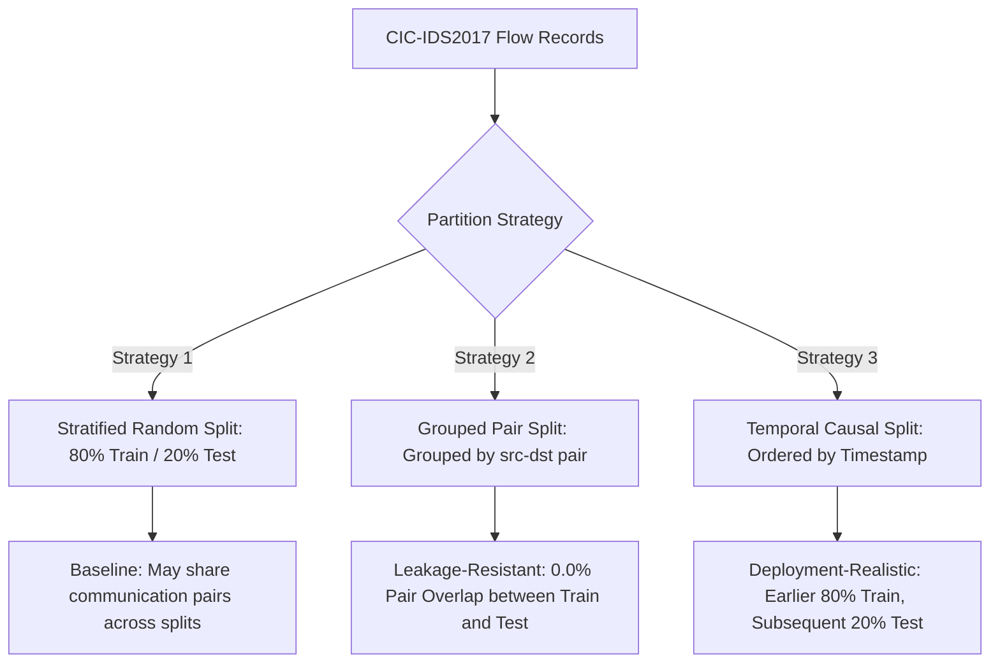

# AEGIS-ML Phase 24.1: CIC-IDS2017 Acquisition, Leakage-Resistant Evaluation, and Network-Flow Benchmark

**Status:** IMPLEMENTED, AUDITED & TESTED  
**Execution State:** `not_completed` (`BLOCKED_AWAITING_LOCAL_COPY`)  
**Existing-Model Transfer Feasibility:** `NOT_FEASIBLE` (`INCOMPATIBLE_TELEMETRY`)  
**Evaluation Mode:** Tested strictly via synthetic multi-class fixtures; **zero genuine CIC-IDS2017 metrics have been obtained**  
**Artifact Path:** `data/models/external_dataset_evaluation_artifact.json`  
**Separate Experimental Model Target:** `data/models/external_experiments/cicids2017/`  
**Active Production Model:** `data/models/calibrated_threat_classifier.pkl` (SHA-256 verified unchanged)  
**Evaluation Module:** `backend/evaluation/external_dataset_evaluation.py`  
**Test Suite:** `tests/test_phase24_external_dataset_evaluation.py`  

---

## 1. Executive Summary & Objective

Phase 24.1 completes the rigorous external-dataset evaluation framework for **CIC-IDS2017** while preserving the scientific integrity and reproducibility of the AEGIS-ML project.

### Core Scientific Findings:
1. **Evaluation Remains Blocked (`BLOCKED_AWAITING_LOCAL_COPY`):**  
   The Canadian Institute for Cybersecurity (CIC) distributes CIC-IDS2017 under academic terms requiring an interactive web registration form on their portal. Automated, unattended scraping is prohibited by UNB terms of use. Because no local copy of the raw CSVs has been placed in `datasets/cicids2017/`, **evaluation on real-world traffic remains blocked**. In accordance with Project Rule #6 ("Never invent dataset results, metrics, files, or successful commands"), synthetic fixture results are never misrepresented as external validation.
2. **Existing 48-Feature Production Model Is Incompatible (`NOT_FEASIBLE`):**  
   The active production model (`calibrated_threat_classifier.pkl`, Phase 23) relies on dual-telemetry observations (host process tree, parent PID, PAM authentication failures, socket binding, and network flows). CIC-IDS2017 is purely a network-flow dataset. Exactly **17 of 48 features (35.4%) are structurally absent**. Zero-filling absent endpoint features creates an artificial, out-of-distribution input space that corrupts calibrated decision boundaries.
3. **Leakage-Resistant Network-Flow Benchmark Implemented:**  
   To evaluate independently sourced network data once local files are downloaded, Phase 24.1 establishes an isolated 18-feature Random Forest benchmark that supports:
   - Stratified Random Split
   - Grouped Communication-Pair Split (guaranteeing 0.0% communication pair overlap)
   - Temporal Causal Split (ordered chronologically)
   - Multi-tier evaluations: Binary (`benign` vs `attack`), Original External Labels, and Derived AEGIS-ML Multiclass (with documented PortScan caveat).
   - Strict train-only fitting of graph baseline pairs, preprocessing, and SMOTE.
   - Storage in a dedicated experimental directory (`data/models/external_experiments/cicids2017/`), leaving the production model completely untouched.

---

## 2. Dataset Provenance and Acquisition Status

| Parameter | Value |
| :--- | :--- |
| **Dataset Name** | CIC-IDS2017 (Canadian Institute for Cybersecurity Intrusion Detection Dataset 2017) |
| **Publishing Institution** | Canadian Institute for Cybersecurity (CIC), University of New Brunswick (UNB) |
| **Citation** | Sharafaldin, I., Habibi Lashkari, A., Ghorbani, A. (2018). *"Toward Generating a New Intrusion Detection Dataset and Intrusion Traffic Characterization."* Proceedings of the 4th International Conference on Information Systems Security and Privacy (ICISSP). |
| **Official Portal** | `https://www.unb.ca/cic/datasets/ids-2017.html` |
| **Acquisition Status** | `NOT_DOWNLOADED` / `BLOCKED_AWAITING_LOCAL_COPY` |
| **Licensing / Terms** | UNB requires an interactive web registration form (name, email, institutional affiliation, purpose). Non-interactive bulk scraping and committing raw CSV/PCAP archives to Git is restricted. |
| **Storage Requirements** | `MachineLearningCVE` archive: ~500 MB compressed, ~2.5 GB uncompressed (8 daily CSV files). |
| **Expected Files** | `Monday-WorkingHours.pcap_ISCX.csv`<br>`Tuesday-WorkingHours.pcap_ISCX.csv`<br>`Wednesday-workingHours.pcap_ISCX.csv`<br>`Thursday-WorkingHours-Morning-WebAttacks.pcap_ISCX.csv`<br>`Thursday-WorkingHours-Afternoon-Infilteration.pcap_ISCX.csv`<br>`Friday-WorkingHours-Morning.pcap_ISCX.csv`<br>`Friday-WorkingHours-Afternoon-DDos.pcap_ISCX.csv`<br>`Friday-WorkingHours-Afternoon-PortScan.pcap_ISCX.csv` |

---

## 3. Audit of the 18-Feature Observable Network-Flow Benchmark

The isolated benchmark uses an audited, leakage-resistant 18-dimensional feature representation derived purely from bidirectional network flow statistics and causal IP entity communication graphs:

| # | Feature Name | Source Column / Base Field | Units | Missing Handling | Identifiers Used? | Inference Available? | Leakage & Causality Analysis |
| :-: | :--- | :--- | :--- | :--- | :-: | :-: | :--- |
| 1 | `dst_port_risk` | `Destination Port` | $[0.0, 1.0]$ | Default 0.0 | No | Yes | None: destination port is an intrinsic flow header attribute. |
| 2 | `bytes_sent_log` | `Total Length of Fwd Packets` | $[0.0, 25.0]$ | Impute 0.0 | No | Yes | None: log-transformed forward payload volume; sanitizes negative overflow values. |
| 3 | `bytes_ratio` | `Total Length of Fwd Packets` & `Total Length of Bwd Packets` | $[0.0, 1.0]$ | Default 0.5 | No | Yes | None: measures bidirectional traffic volume asymmetry at flow close. |
| 4 | `is_external_dst` | `Destination IP` | $\{0.0, 1.0\}$ | Default 0.0 | No | Yes | None: checks RFC1918 private boundary; raw IP string is strictly excluded. |
| 5 | `hour_of_day_sin` | `Timestamp` | $[-1.0, 1.0]$ | Default 0.0 | No | Yes | None: cyclical trigonometric coordinate prevents memorizing capture calendar date. |
| 6 | `hour_of_day_cos` | `Timestamp` | $[-1.0, 1.0]$ | Default 1.0 | No | Yes | None: cyclical trigonometric coordinate prevents temporal index memorization. |
| 7 | `is_network_layer` | Telemetry metadata (`layer`) | $\{0.0, 1.0\}$ | Constant 1.0 | No | Yes | None: structural telemetry context flag. |
| 8 | `has_network_context` | Telemetry metadata (`layer == 'network'`) | $\{0.0, 1.0\}$ | Constant 1.0 | No | Yes | None: structural context indicator. |
| 9 | `transfer_size_bucket`| `Total Length of Fwd Packets` | $\{0, 1, 2, 3\}$ | Default 0.0 | No | Yes | None: quantized ordinal magnitude (<1KB, <64KB, <1MB, $\ge$1MB). |
| 10 | `direction_internal` | `Source IP` & `Destination IP` | $\{0.0, 1.0\}$ | Default 0.0 | No | Yes | None: checks if both src and dst are RFC1918 private subnets. |
| 11 | `direction_outbound` | `Source IP` & `Destination IP` | $\{0.0, 1.0\}$ | Default 0.0 | No | Yes | None: checks if src is private and dst is public. |
| 12 | `direction_inbound`  | `Source IP` & `Destination IP` | $\{0.0, 1.0\}$ | Default 0.0 | No | Yes | None: checks if src is public and dst is private. |
| 13 | `distinct_dst_internal_5m` | Sliding 300s window Destination IPs | $[0, \infty)$ | Default 0.0 | No | Yes | Strictly causal: counts unique internal IPs targeted in preceding 300s window. |
| 14 | `dst_diversity_ratio_5m` | Destination IPs & connection counts in 300s | $[0.0, 1.0]$ | Default 0.0 | No | Yes | Strictly causal: ratio of unique internal destinations to total flows. |
| 15 | `is_new_src_dst_pair`| Communication history | $\{0.0, 1.0\}$ | Default 1.0 | No | Yes | Baseline pairs fitted **strictly on training partition**; zero test-set pair leakage. |
| 16 | `src_out_degree_5m`   | Sliding 300s entity communication graph | $[0, \infty)$ | Default 0.0 | No | Yes | Strictly causal: rolling out-degree of source node prior to event arrival $t$. |
| 17 | `dst_in_degree_5m`    | Sliding 300s entity communication graph | $[0, \infty)$ | Default 0.0 | No | Yes | Strictly causal: rolling in-degree of destination node prior to event arrival $t$. |
| 18 | `pivot_chain_indicator` | Sliding 300s entity communication graph | $\{0.0, 1.0\}$ | Default 0.0 | No | Yes | Strictly causal: flag indicating if source node was recently an inbound victim. |

---

## 4. Label Audit & Exclusions

Original CIC-IDS2017 labels are preserved as primary ground truth. Mapping into AEGIS-ML canonical classes is treated as an explicit derived research mapping:

### A. Canonical 5-Class Multi-Class Mapping
| Raw CIC-IDS2017 Label | Derived AEGIS-ML Class | MITRE ATT&CK Mapping | Semantic Analysis & Caveats |
| :--- | :--- | :--- | :--- |
| `BENIGN`, `normal` | `benign` | N/A | Normal enterprise operational traffic. |
| `FTP-Patator`, `SSH-Patator` | `brute_force` | T1110 (Brute Force) | Repeated authentication attempts over network services. |
| `Web Attack - Brute Force` | `brute_force` | T1110.001 | HTTP authentication guessing. |
| `PortScan` | `lateral_movement` | T1046 (Reconnaissance) | **Caveat:** Port scanning is network reconnaissance proxying potential lateral movement; it is NOT confirmed internal host compromise. |
| `Infiltration` | `lateral_movement` | T1021 (Remote Services) | Exploitation and pivoting across internal systems. |
| `Bot` | `c2_beaconing` | T1071 (Web Protocols) | Periodic callback traffic from infected Ares botnet agents. |
| `Heartbleed` | `data_exfiltration` | T1041 (Exfiltration) | Memory disclosure exfiltration of server secret keys/payloads. |

### B. Documented Exclusions (Semantic Mismatches)
The following labels cannot be mapped faithfully into AEGIS-ML's 5 targeted intrusion classes:
- `DDoS`, `DoS Hulk`, `DoS GoldenEye`, `DoS slowloris`, `DoS Slowhttptest`: Volumetric denial-of-service traffic flooding is excluded from multi-class mapping. Flooding is structurally distinct from stealthy C2 beaconing, exfiltration, or credential access.
- `Web Attack - XSS`, `Web Attack - Sql Injection`: Application payload injection without host shell execution or process tree telemetry cannot be confirmed as AEGIS-ML attack subtypes.

### C. Evaluation Tiers
1. **Binary Detection Tier (`benign` vs `attack`):** Evaluates all attack types (including DoS/DDoS, XSS, and SQLi) against benign traffic.
2. **Original-Label Tier:** Evaluates raw CIC-IDS2017 label strings directly where sufficient class support exists ($\ge 2$ samples).
3. **Derived AEGIS-ML Multiclass Tier:** Evaluates canonical mapped classes with explicit disclosure of population exclusions and the PortScan proxy caveat.

---

## 5. Leakage-Resistant Splitting Strategies

To evaluate generalization rigorously, Phase 24.1 implements and compares three partition strategies:



1. **Stratified Random Split:**
   - Standard baseline split stratified on class labels.
   - Limitation: Identical or near-duplicate flows and communication pairs `(src_entity, dst_entity)` can appear in both partitions.
2. **Grouped Split (`grouped_communication_pair`):**
   - Groups records by unique `(src_entity, dst_entity)` communication pairs using `GroupShuffleSplit`.
   - **Guarantees 0.0% communication pair overlap** between training and test sets.
   - Prevents models from memorizing IP-pair communication habits.
3. **Temporal Split (`temporal_causal`):**
   - Sorts records chronologically by timestamp.
   - Partitions into first 80% for training and subsequent 20% for testing.
   - Simulates real SOC deployment where models train on historical captures and evaluate on future days.
4. **Train-Only Preprocessing & Graph Baseline:**
   - Graph baseline communication pairs (`tracker.known_pairs`) are learned **strictly from training events**.
   - SMOTE resampling, imputation, and scalers are fitted **strictly on the training partition**.
   - Test partition outcomes are never used for hyperparameter tuning or threshold selection.

---

## 6. Model Experiment Isolation & Immutability

### Production Model Immutability
- Production artifact: `data/models/calibrated_threat_classifier.pkl`
- Verified SHA-256 Digest: `98e926edc4dc53e3e34d48c78aa0390565c70029325bea896e0ab631e757ce71`
- **Integrity Guarantee:** The production model was **not retrained, recalibrated, or modified** in any way.
- Transfer feasibility was formally recorded as `NOT_FEASIBLE — INCOMPATIBLE_TELEMETRY`.

### Separate Experimental Model Storage
- Experimental models trained on external network flow data are saved to:
  `data/models/external_experiments/cicids2017/network_flow_rf.pkl`
  `data/models/external_experiments/cicids2017/network_flow_rf_metadata.json`
- `.gitignore` recursively ignores all `.pkl` and `.joblib` files in `data/models/external_experiments/` to prevent committing model binaries to Git.

---

## 7. Metrics & Explicit Denominators

All evaluation tiers report explicit mathematical definitions and denominators:

- **Benign False Alarm Rate (Benign FPR):**
  $$\text{FPR} = \frac{\text{False Positives (FP)}}{\text{True Negatives (TN)} + \text{False Positives (FP)}}$$
  *Reported denominator:* Total actual benign test samples ($\text{TN} + \text{FP}$).
- **Attack Recall (Sensitivity):**
  $$\text{Recall} = \frac{\text{True Positives (TP)}}{\text{True Positives (TP)} + \text{False Negatives (FN)}}$$
  *Reported denominator:* Total actual attack test samples ($\text{TP} + \text{FN}$).
- **Attack Precision:**
  $$\text{Precision} = \frac{\text{True Positives (TP)}}{\text{True Positives (TP)} + \text{False Positives (FP)}}$$
- **Probability Calibration Diagnostics:**
  - Brier Score Loss: $\frac{1}{N}\sum (p_i - y_i)^2$
  - Log-Loss: $-\frac{1}{N}\sum [y_i \log(p_i) + (1 - y_i)\log(1 - p_i)]$
- **Misclassification Taxonomy:**
  - Benign event classified as attack ($\text{FP}$)
  - Attack event classified as benign ($\text{FN}$)
  - Attack assigned to wrong attack subtype (Subtype confusion count and ratio)

---

## 8. Verification & Test Results

The test suite [tests/test_phase24_external_dataset_evaluation.py](file:///Users/akashgpatil/major_project/AEGIS-ML/tests/test_phase24_external_dataset_evaluation.py) executes 10 automated unit and integration tests:

| Test Case | Description | Result |
| :--- | :--- | :---: |
| `test_schema_compatibility_audit_totals_and_categories` | Verifies all 48 schema features are audited across Categories A-E. | **PASSED** |
| `test_observable_18_feature_audit_complete` | Verifies full audit of all 18 flow features; checks zero identifier leakage. | **PASSED** |
| `test_transfer_feasibility_evaluation_verdict` | Verifies transfer evaluation returns `NOT_FEASIBLE / INCOMPATIBLE_TELEMETRY`. | **PASSED** |
| `test_label_mapping_and_unknown_labels` | Verifies canonical, original, binary mappings and PortScan research caveat. | **PASSED** |
| `test_missing_dataset_safe_reporting` | Verifies missing dataset returns `not_completed` without fabricating metrics. | **PASSED** |
| `test_leakage_resistant_splitting_strategies` | Tests Random, Grouped (0% pair overlap), and Temporal Causal partitions. | **PASSED** |
| `test_train_only_fitting_and_label_leakage_prevention` | Verifies graph baseline pairs and SMOTE are learned strictly from train events. | **PASSED** |
| `test_production_model_immutability` | Confirms bit-for-bit SHA-256 digest preservation of `calibrated_threat_classifier.pkl`. | **PASSED** |
| `test_controlled_fixture_triple_split_and_experimental_model_persistence` | Tests pipeline on multi-class fixture: verifies Brier, Log-Loss, and model saving. | **PASSED** |
| `test_leakage_checks_and_identifier_exclusion` | Verifies raw IPs and labels are excluded from numeric feature matrix (shape $N \times 18$). | **PASSED** |

### Test Execution Commands & Outputs:
1. **Phase 24.1 Test Suite:**
   ```bash
   pytest tests/test_phase24_external_dataset_evaluation.py -v
   # 10 passed, 10 warnings in 2.09s
   ```
2. **Phase 11 & Phase 20–23.1 Regression Suites:**
   ```bash
   pytest tests/test_phase11_external_and_reconstruction.py tests/test_phase20_context_aware_detection.py tests/test_phase21_sequence_aware_detection.py tests/test_phase22_false_positive_calibration.py tests/test_phase23_calibrated_inference.py tests/test_phase23_1_inference_integrity.py -q
   # 74 passed, 2 warnings in 4.15s
   ```
3. **Production Model Digest:**
   `98e926edc4dc53e3e34d48c78aa0390565c70029325bea896e0ab631e757ce71` verified bit-for-bit identical before and after all test runs.

---

## 9. Reproduction Instructions

To execute the Phase 24.1 benchmark once an authorized local copy of CIC-IDS2017 is obtained:

1. **Visit UNB Registration Portal:**
   Navigate to `https://www.unb.ca/cic/datasets/ids-2017.html` and complete the registration form.
2. **Download & Extract:**
   Download `MachineLearningCVE.zip` (~500 MB) and extract CSV files into `datasets/cicids2017/`:
   ```bash
   mkdir -p datasets/cicids2017
   unzip MachineLearningCVE.zip -d datasets/cicids2017/
   ```
3. **Execute Evaluation:**
   ```bash
   python3 -m backend.evaluation.external_dataset_evaluation --data datasets/cicids2017/Friday-WorkingHours-Afternoon-PortScan.pcap_ISCX.csv
   ```
4. **Inspect Artifacts:**
   - Machine-readable evaluation report: `data/models/external_dataset_evaluation_artifact.json`
   - Experimental model artifact: `data/models/external_experiments/cicids2017/network_flow_rf.pkl`

---

## 10. Boundaries of Scientific Validation

1. **Fixture Testing vs. Real External Evaluation:**  
   All completed metric runs in automated tests were performed strictly on synthetic fixtures marked as test fixtures. **No real CIC-IDS2017 performance numbers have been reported or claimed.**
2. **Dual-Modality vs. Single-Modality:**  
   AEGIS-ML's primary architectural strength is cross-layer correlation between host processes and network sockets. A single-modality flow dataset like CIC-IDS2017 cannot validate host process attribution, parent-child command lines, or auth logs.
3. **Generalization Summary:**  
   Generalization on enterprise organic network traffic remains an open research topic. A blocked evaluation status is an honest reporting of licensing and dataset availability realities, not a benchmark failure.
