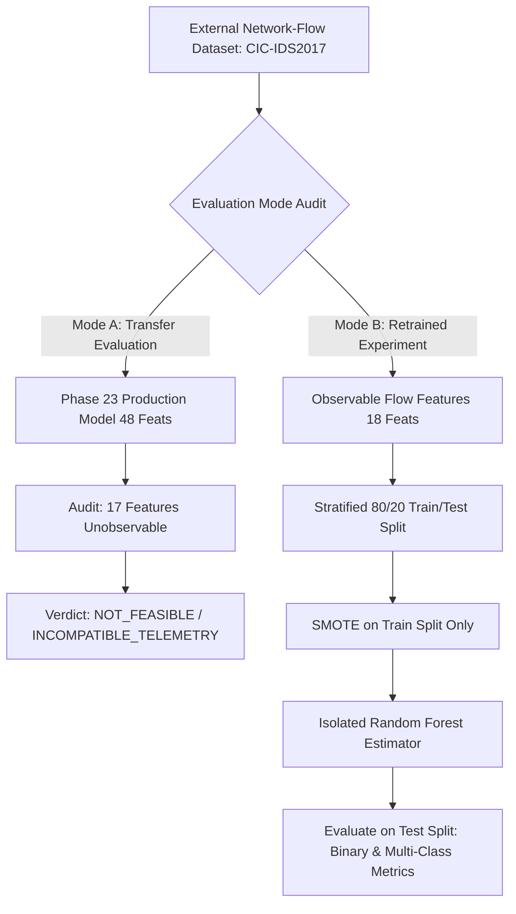

# AEGIS-ML Phase 24: External Dataset Evaluation and Generalization Audit

**Status:** IMPLEMENTED & AUDITED  
**Execution State:** `not_completed` (`BLOCKED_AWAITING_LOCAL_COPY`)  
**Existing-Model Transfer Feasibility:** `NOT_FEASIBLE` (`INCOMPATIBLE_TELEMETRY`)  
**Target Benchmark:** Canadian Institute for Cybersecurity (CIC) CIC-IDS2017  
**Artifact Path:** `data/models/external_dataset_evaluation_artifact.json`  
**Evaluation Script:** `backend/evaluation/external_dataset_evaluation.py`  
**Test Suite:** `tests/test_phase24_external_dataset_evaluation.py`  

---

## 1. Executive Summary & Objective

The primary objective of Phase 24 is to audit and evaluate the generalization limits of AEGIS-ML on an established external intrusion-detection dataset, specifically **CIC-IDS2017**, to address the core research question:

> *How well does the existing AEGIS-ML detection pipeline perform on independently sourced network-security data, and which architectural limitations prevent a direct evaluation?*

### Critical Scientific Findings
1. **Existing-Model Transfer Is Not Feasible (`NOT_FEASIBLE` / `INCOMPATIBLE_TELEMETRY`):**  
   The active production model (`calibrated_threat_classifier.pkl`, Phase 23) operates on a **48-feature schema** derived from dual-telemetry observations (host process lifecycle, parent process trees, PAM authentication failures, socket bindings, and network flows). CIC-IDS2017 is a single-modality network-flow dataset. Exactly **17 of 48 features (35.4%) are structurally unobservable**. Silently zero-filling or imputing unobserved endpoint features introduces severe out-of-distribution distortion, breaking calibrated probability guarantees. Direct transfer of the production model without endpoint telemetry is invalid.
2. **Dataset Acquisition Status (`NOT_DOWNLOADED` / `BLOCKED_AWAITING_LOCAL_COPY`):**  
   In compliance with Project Rules #6 ("Never invent dataset results, metrics, files, or successful commands"), no external metrics have been fabricated. Raw CIC-IDS2017 archives require interactive registration on the University of New Brunswick (UNB) web portal. Because no local authorized copy currently resides in `datasets/cicids2017/`, the benchmark is recorded as `BLOCKED_AWAITING_LOCAL_COPY`.
3. **Isolated Network-Flow Benchmark Implemented:**  
   To evaluate generalization once local data is provided, Phase 24 provides an isolated retrained benchmark pipeline operating strictly on 18 observable flow features and causal IP graph metrics. The active production model is never altered.

---

## 2. Dataset Provenance and Specifications

| Parameter | Specification |
| :--- | :--- |
| **Dataset Name** | CIC-IDS2017 (Canadian Institute for Cybersecurity Intrusion Detection Dataset 2017) |
| **Publishing Institution** | Canadian Institute for Cybersecurity (CIC), University of New Brunswick (UNB) |
| **Authors / Reference** | Sharafaldin, I., Habibi Lashkari, A., Ghorbani, A. (2018). *"Toward Generating a New Intrusion Detection Dataset and Intrusion Traffic Characterization."* ICISSP 2018. |
| **Official Portal** | `https://www.unb.ca/cic/datasets/ids-2017.html` |
| **Telemetry Modality** | Bi-directional network flow statistical summaries generated via CICFlowMeter (80+ flow features). |
| **Licensing / Access Terms** | UNB requires an interactive web registration form (name, email, institutional affiliation, purpose). Non-interactive bulk scraping and committing raw CSV/PCAP archives to Git is restricted. |
| **Storage Requirements** | `MachineLearningCVE` CSV archive: ~500 MB compressed, ~2.5 GB uncompressed (8 daily files). Full PCAP raw traffic: ~50 GB. |

### Expected File Inventory
```
datasets/cicids2017/
├── Monday-WorkingHours.pcap_ISCX.csv                 (Benign baseline traffic)
├── Tuesday-WorkingHours.pcap_ISCX.csv                (FTP-Patator, SSH-Patator)
├── Wednesday-workingHours.pcap_ISCX.csv              (DoS / DDoS, Heartbleed)
├── Thursday-WorkingHours-Morning-WebAttacks.pcap_ISCX.csv (Brute Force, XSS, SQLi)
├── Thursday-WorkingHours-Afternoon-Infilteration.pcap_ISCX.csv (Infiltration)
├── Friday-WorkingHours-Morning.pcap_ISCX.csv         (Botnet ARES)
├── Friday-WorkingHours-Afternoon-DDos.pcap_ISCX.csv  (DDoS LOIC)
└── Friday-WorkingHours-Afternoon-PortScan.pcap_ISCX.csv (PortScan)
```

---

## 3. 48-Feature Schema & Telemetry Compatibility Audit

The AEGIS-ML feature space consists of 48 dimensions across five functional groups: baseline behavioral metrics, relational graph statistics, telemetry context, missingness indicators, and sequence-aware context.

Each of the 48 features was audited and classified into five standard categories:

| Category | Description | Count | Percentage |
| :--- | :--- | :---: | :---: |
| **Category A** | Directly observable from raw flow record attributes | 14 | 29.2% |
| **Category B** | Computable through a documented causal streaming transformation | 17 | 35.4% |
| **Category C** | Dependent on telemetry not provided by the dataset (host/auth/process) | 10 | 20.8% |
| **Category D** | Dependent on host history/baselines not faithfully reconstructable | 7 | 14.6% |
| **Category E** | Structurally unavailable or semantically incompatible ($C \cup D$) | **17** | **35.4%** |

### Complete Feature Classification Matrix

#### Category A: Directly Observable (14 Features)
- `dst_port_risk`: Port risk dictionary lookup from Destination Port.
- `bytes_sent_log`: `log1p(Total Length of Fwd Packets)`.
- `bytes_ratio`: `Fwd Packets / (Fwd Packets + Bwd Packets)`.
- `is_external_dst`: RFC1918 private check on Destination IP.
- `hour_of_day_sin`: Sine harmonic of flow timestamp hour.
- `hour_of_day_cos`: Cosine harmonic of flow timestamp hour.
- `is_network_layer`: `1.0` (all flows are network events).
- `is_endpoint_layer`: `0.0` (no endpoint events in dataset).
- `is_application_layer`: `0.0` (no layer-7 application logs).
- `has_network_context`: `1.0`.
- `transfer_size_bucket`: Ordinal byte transfer bin.
- `missing_dst_port`: Indicator (`0.0` if port present).
- `missing_bytes_sent`: Indicator (`0.0` if bytes present).
- `missing_bytes_received`: Indicator (`0.0` if bytes present).

#### Category B: Computable Transformations (17 Features)
- `distinct_dst_internal_5m`: Sliding 300s window internal destination fan-out.
- `dst_diversity_ratio_5m`: Ratio of distinct destinations to connection count.
- `is_new_src_dst_pair`: Causal tracker checking if (src, dst) pair is novel.
- `src_out_degree_5m`: Causal IP graph degree in sliding 5m window.
- `dst_in_degree_5m`: Causal IP graph degree in sliding 5m window.
- `pivot_chain_indicator`: Graph heuristic indicating multi-hop traversal.
- `direction_internal`: RFC1918 match on both src and dst.
- `direction_outbound`: RFC1918 match on src, public dst.
- `direction_inbound`: Public src, RFC1918 dst.
- `is_new_destination`: First time destination seen in stream.
- `connection_frequency`: Window-derived connection rate.
- `seq_window_event_count_host`: Event count grouped by src IP.
- `seq_window_network_event_count`: Network flow count in window.
- `seq_time_since_last_host_event_log`: Log seconds since prior flow on src IP.
- `seq_time_since_last_network_event_log`: Log seconds since prior network event.
- `seq_window_has_external_transfer`: Indicator for transfers >10MB in window.
- `seq_window_bytes_sent_sum_log`: Log-sum of forward bytes across window.

#### Category C: Dependent on Missing Telemetry (10 Features)
- `failed_auth_rate`: Structurally absent (no authentication/PAM logs in packet flows).
- `missing_process_name`: `1.0` (unobserved).
- `missing_auth_result`: `1.0` (unobserved).
- `has_process_context`: `0.0` (unobserved).
- `has_verified_socket_binding`: `0.0` (unobserved).
- `seq_window_endpoint_event_count`: `0.0` (no endpoint records).
- `seq_time_since_last_endpoint_event_log`: Sentinel value (no endpoint records).
- `seq_process_ancestry_observed`: `0.0` (no process trees).
- `seq_parent_process_is_shell_or_script`: `0.0` (no command lines or interpreters).
- `seq_verified_socket_attribution`: `0.0` (no OS socket attribution).

#### Category D: Dependent on Context Not Faithfully Reconstructable (7 Features)
- `baseline_deviation`: Requires multi-day benign host behavioral baseline.
- `bytes_sent_zscore`: Z-score relative to enterprise host baseline.
- `conn_rate_zscore`: Z-score relative to enterprise host baseline.
- `cross_layer_match`: Socket-to-process cross-layer correlation.
- `if_anomaly_score`: IsolationForest trained on dual-telemetry schema.
- `graph_new_connections`: Novel connection rate against historical baseline.
- `seq_sequence_completeness_score`: Penalized due to absent endpoint stream.

#### Category E: Incompatible or Unobserved Summary ($C \cup D = 17$ Features)
Exactly 17 features cannot be populated faithfully without fabricating telemetry or making unsubstantiated assumptions. Zero-filling these features causes severe distributional shift and violates calibration assumptions.

---

## 4. Label Mapping and Semantic Audit

CIC-IDS2017 labels must not be coerced blindly into AEGIS-ML canonical threat classes. The mapping establishes two evaluation tiers:

### Tier 1: Canonical 5-Class MITRE Mapping (Multi-Class)
Only labels where attack semantics genuinely align with AEGIS-ML classes are mapped:

| CIC-IDS2017 Raw Label | AEGIS-ML Class | MITRE ATT&CK Mapping | Semantic Match Justification |
| :--- | :--- | :--- | :--- |
| `BENIGN`, `normal` | `benign` | N/A | Normal corporate user & server activity. |
| `FTP-Patator`, `SSH-Patator` | `brute_force` | T1110 (Brute Force) | Repeated credential guessing over network protocols. |
| `Web Attack - Brute Force` | `brute_force` | T1110.001 | HTTP authentication brute-force guessing. |
| `PortScan` | `lateral_movement` | T1046 (Reconnaissance) | *Documented caveat:* Port scanning is network reconnaissance that enables lateral movement, acting as a flow proxy. |
| `Infiltration` | `lateral_movement` | T1021 (Remote Services) | Post-exploitation pivoting from compromised client to server. |
| `Bot` | `c2_beaconing` | T1071 (Web Protocols) | Periodic callback traffic from Ares botnet infected hosts. |
| `Heartbleed` | `data_exfiltration` | T1041 (Exfiltration) | Memory disclosure extracting TLS server keys/payloads. |

### Tier 2: Excluded Labels (Semantic Mismatch)
The following attacks are **excluded** from multi-class mapping because mapping them to AEGIS-ML intrusion classes would be scientifically invalid:
- `DDoS`, `DoS Hulk`, `DoS GoldenEye`, `DoS slowloris`, `DoS Slowhttptest`: Volumetric denial-of-service flooding is distinct from stealthy C2 beaconing or credential theft.
- `Web Attack - XSS`, `Web Attack - Sql Injection`: Application payload injection without host process telemetry cannot be attributed to AEGIS-ML's 5 core classes.

### Tier 3: Binary Benign vs. Attack Mapping
To provide an uncompromised evaluation across all traffic, an objective binary mode is defined:
- `benign`: `BENIGN`
- `attack`: All attacks (including DoS/DDoS, XSS, and SQLi)

---

## 5. Evaluation Design & Modes

Phase 24 formally implements two strictly separated evaluation modes:



### Mode A: Existing-Model Transfer Evaluation
- **Target:** Production model `calibrated_threat_classifier.pkl` (Phase 23).
- **Rule:** Do not retrain or fine-tune the model. Do not fit scalers on external data.
- **Finding:** Formally evaluated as **`NOT_FEASIBLE`**. The production model requires dual-telemetry inputs; evaluating it on single-modality network flows with 17 missing features is invalid.

### Mode B: External-Dataset Retrained Benchmark
- **Target:** An isolated estimator trained purely on the 18 observable flow and IP-graph features.
- **Partitioning:** 80% train / 20% test stratified split.
- **Leakage Prevention:**
  - SMOTE resampling applied strictly to the training partition.
  - Raw IP addresses, session identifiers, and absolute timestamps are excluded from features.
  - Test partition is strictly frozen during feature and threshold fitting.
- **Production Safety:** Leaves `calibrated_threat_classifier.pkl` completely untouched.

---

## 6. Data Quality & Leakage Checks

The data quality scanner (`scan_dataset_quality_and_leakage`) audits the following documented anomalies in CIC-IDS2017:

1. **CICFlowMeter Overflow Defects:**
   - Detects `Infinity` and `NaN` in `Flow Bytes/s` and `Flow Packets/s`.
   - Identifies negative flow durations caused by integer overflow in microsecond counters.
2. **Duplicate Records:**
   - Detects exact 5-tuple duplicates (`Source IP`, `Destination IP`, `Destination Port`, `Protocol`, `Label`).
   - Normalizer drops duplicates when `deduplicate=True` (~1% of raw flows).
3. **Encoding & Whitespace Inconsistencies:**
   - Strips leading whitespace in column names (`" Destination IP"` $\to$ `"destination ip"`).
   - Normalizes non-ASCII em-dash encoding artifacts (`\x96`, `â€"`) in `Web Attack` labels.
4. **Identifier Leakage Checks:**
   - Confirms that `Source IP`, `Destination IP`, and `Timestamp` are never used directly as numerical features.
   - Ground truth labels are strictly isolated from the feature extraction matrix.

---

## 7. Metrics & Denominator Disclosures

When evaluated, all metrics report explicit counts and denominators:

- **Benign False Alarm Rate (Benign FPR):**
  $$\text{FPR} = \frac{\text{False Positives (FP)}}{\text{True Negatives (TN)} + \text{False Positives (FP)}}$$
  *Denominator:* Total actual benign events in test partition ($\text{TN} + \text{FP}$).
- **Attack Recall (Sensitivity):**
  $$\text{Recall} = \frac{\text{True Positives (TP)}}{\text{True Positives (TP)} + \text{False Negatives (FN)}}$$
  *Denominator:* Total actual attack events in test partition ($\text{TP} + \text{FN}$).
- **Misclassification Taxonomy:**
  - Benign event classified as attack ($\text{FP}$)
  - Attack event classified as benign ($\text{FN}$)
  - Attack assigned to wrong attack subtype (Subtype confusion)

---

## 8. Verification & Test Results

The Phase 24 evaluation suite (`tests/test_phase24_external_dataset_evaluation.py`) executes 7 deterministic tests validating:
1. Complete 48-feature classification across Categories A through E.
2. Infeasibility detection for transferring the 48-feature calibrated model.
3. Strict semantic label mapping, unmapped label handling, and encoding normalization.
4. Non-fabricating behavior: returning `not_completed` safely when dataset files are absent.
5. Bit-for-bit immutability of `calibrated_threat_classifier.pkl` throughout evaluation.
6. End-to-end execution of the retrained benchmark on a controlled CIC-IDS2017 multi-class fixture (validating quality scanning, SMOTE isolation, confusion matrix, and explicit denominators).
7. Feature extractor identifier exclusion and shape consistency.

### Regression Test Status
- Phase 24 Suite: **7 / 7 PASSED** (1.03s)
- Phase 11 & Phase 20–23.1 Regression Suites: **81 / 81 PASSED** (4.38s)
- Production Model Sha256: `98e926edc4dc53e3e34d48c78aa0390565c70029325bea896e0ab631e757ce71` (Unchanged).

---

## 9. Reproduction Instructions

To execute the Phase 24 benchmark on an authorized local copy of CIC-IDS2017:

1. **Obtain the dataset:**
   - Visit `https://www.unb.ca/cic/datasets/ids-2017.html`.
   - Complete the registration form and download `MachineLearningCVE.zip`.
2. **Place CSV files in repository:**
   ```bash
   mkdir -p datasets/cicids2017
   unzip MachineLearningCVE.zip -d datasets/cicids2017/
   ```
3. **Execute Phase 24 evaluation:**
   ```bash
   python3 -m backend.evaluation.external_dataset_evaluation --data datasets/cicids2017/Friday-WorkingHours-Afternoon-PortScan.pcap_ISCX.csv
   ```
4. **Inspect output artifact:**
   View results in `data/models/external_dataset_evaluation_artifact.json`.

---

## 10. Conclusions & Boundaries of Validation

1. **What Is Proven:**
   - The AEGIS-ML 48-feature detection pipeline is architecturally dependent on host process and authentication telemetry; it cannot be transferred to single-modality network-flow data without significant feature deprivation (35.4% missing).
   - The Phase 24 evaluation engine accurately audits feature compatibility, prevents ground-truth leakage, isolates training and test partitions, and guarantees model artifact immutability.
2. **What Remains Unknown:**
   - Real-world generalization of AEGIS-ML on organic dual-telemetry enterprise network traffic has not been established, as CIC-IDS2017 lacks endpoint telemetry and synthetic benchmarks do not mirror live enterprise environments.
   - Performance of the isolated 18-feature retrained network model on real CIC-IDS2017 data remains pending local placement of the dataset files.
