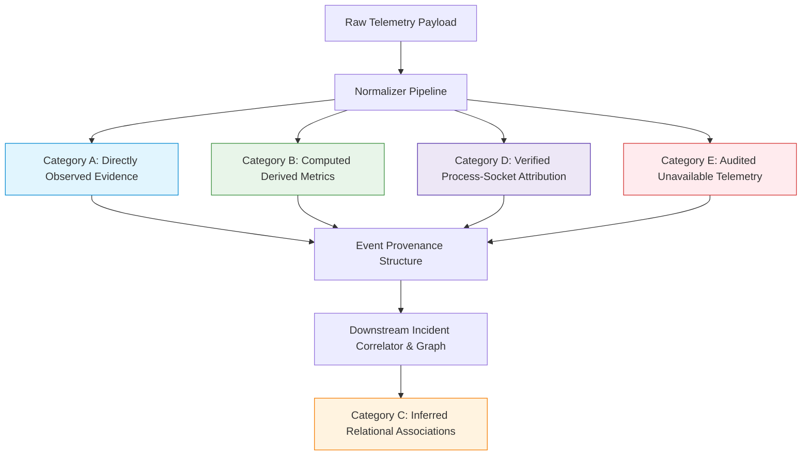

# AEGIS-ML Phase 25: Streaming Ingestion and Telemetry Normalization

## Executive Summary

Phase 25 establishes a robust, maintainable ingestion and telemetry normalization layer for AEGIS-ML. This layer bridges raw heterogeneous telemetry sources (network flows, endpoint process and file actions, application HTTP/auth events) into the canonical `UnifiedEvent` representation consumed by AEGIS-ML's detection, sequence tracking, graph extraction, and incident correlation engines.

Crucially, the normalization and ingestion pipeline enforces strict semantic discipline:
1. **Evidence Provenance Preservation**: Maintains clear boundaries between directly observed facts, computed derived metrics, downstream inferred relationships, verified process-socket attribution, and unavailable telemetry.
2. **Deterministic Timezone Coercion**: Normalizes all incoming timestamps (ISO-8601 strings, UNIX epoch timestamps in seconds, milliseconds, or microseconds) to UTC, while cleanly distinguishing event occurrence time from ingestion arrival time.
3. **Multi-Tier Deduplication**: Detects exact duplicate event identifiers via bounded LRU caching and duplicate retransmissions via an invariant payload SHA-256 fingerprint within a sliding time window (60s).
4. **Watermarking & Late-Event Handling**: Tracks stream high-watermarks, flags out-of-order and late-arriving events (>300s behind watermark), and isolates them from rolling causal sequences to prevent retroactive corruption of completed time windows.
5. **Causal State & Host Isolation**: Guarantees that historical event buffers in sequence and graph trackers remain strictly partitioned by host, with zero cross-host contamination.
6. **Robust Batch API**: Provides FastAPI endpoints (`/api/ingest/event`, `/api/ingest/batch`, `/api/ingest/stats`, `/api/ingest/reset`) enforcing request bounds (max 500 events per batch) and handling partial batch failures gracefully.

> **CRITICAL ARCHITECTURAL DISCLAIMER**: The system's ability to ingest, validate, and normalize events into canonical schemas does **not** establish real-world detection accuracy, generalization across novel enterprise architectures, or adversarial evasion robustness. Normalization is a prerequisite data-quality gate, not proof of downstream ML effectiveness.

---

## 1. Canonical Event Schema (`UnifiedEvent`)

The canonical schema in [`backend/core/schemas.py`](file:///Users/akashgpatil/major_project/AEGIS-ML/backend/core/schemas.py) refines `UnifiedEvent` with Phase 25 ingestion fields while retaining 100% backward compatibility:

| Field | Type | Default | Semantic Description |
|---|---|---|---|
| `event_id` | `str` | UUIDv4 | Unique identifier for the individual telemetry record. |
| `timestamp` | `datetime` | Required | Event occurrence timestamp, coerced to UTC naive representation. |
| `ingestion_timestamp` | `Optional[datetime]` | `None` | Wall-clock timestamp when the event entered the AEGIS-ML pipeline. |
| `layer` | `Literal["network", "endpoint", "application"]` | Required | Observable architectural telemetry plane. |
| `src_entity` | `str` | Required | Originating actor, host IP, or user account. |
| `dst_entity` | `str` | Required | Destination host, remote port, target file, or endpoint route. |
| `src_internal` | `bool` | Required | Whether source entity resolves to internal/private subnets. |
| `dst_internal` | `bool` | Required | Whether destination entity resolves to internal/private subnets. |
| `src_ip` | `Optional[str]` | `None` | Validated IPv4 or IPv6 address of sender. |
| `dst_ip` | `Optional[str]` | `None` | Validated IPv4 or IPv6 address of recipient. |
| `src_port` | `Optional[int]` | `None` | Source transport port (bounded [0, 65535]). |
| `dst_port` | `Optional[int]` | `None` | Destination transport port (bounded [0, 65535]). |
| `protocol` | `Optional[str]` | `None` | Canonical protocol name ("TCP", "UDP", "ICMP", "IP", etc.). |
| `bytes_sent` | `Optional[int]` | `None` | Non-negative byte volume transmitted. |
| `bytes_received` | `Optional[int]` | `None` | Non-negative byte volume received. |
| `packets_sent` | `Optional[int]` | `None` | Non-negative packet count transmitted. |
| `packets_received` | `Optional[int]` | `None` | Non-negative packet count received. |
| `duration_ms` | `Optional[int]` | `None` | Elapsed duration in milliseconds (converted from microseconds when detected). |
| `tcp_flags` | `Optional[str]` | `None` | Observed TCP control flags (e.g. "SYN", "ACK", "FIN"). |
| `host_id` | `Optional[str]` | `None` | Machine hostname or agent identifier. |
| `process_name` | `Optional[str]` | `None` | Executable binary name (e.g. "curl.exe", "powershell.exe"). |
| `parent_process` | `Optional[str]` | `None` | Parent process executable binary name. |
| `pid` | `Optional[int]` | `None` | Operating system process identifier (non-negative integer). |
| `parent_pid` | `Optional[int]` | `None` | Operating system parent process identifier (non-negative integer). |
| `user_account` | `Optional[str]` | `None` | Executing user account or security principal. |
| `file_path` | `Optional[str]` | `None` | Target filesystem path for endpoint file operations. |
| `action` | `Optional[str]` | `None` | Sensor-reported action (e.g. "execute", "read", "write", "connect"). |
| `socket_id` | `Optional[str]` | `None` | Genuine OS socket handle binding process to transport stream. |
| `process_guid` | `Optional[str]` | `None` | Unique process GUID from EDR sensor (e.g. Sysmon). |
| `http_method` | `Optional[str]` | `None` | Normalized HTTP verb ("GET", "POST", "PUT", etc.). |
| `endpoint_path` | `Optional[str]` | `None` | Request URI path (e.g. "/api/v1/auth"). |
| `status_code` | `Optional[int]` | `None` | HTTP response status code (e.g. 200, 401, 500). |
| `auth_result` | `Optional[str]` | `None` | Authentication outcome ("success", "failure", "denied"). |
| `schema_version` | `str` | `"25.0.0"` | Canonical schema contract version. |
| `source_system` | `Optional[str]` | `None` | Producer identifier (e.g. "zeek", "sysmon", "suricata", "app_gateway"). |
| `missing_fields` | `List[str]` | `[]` | List of expected layer fields unobserved or unavailable in raw telemetry. |
| `provenance` | `Optional[Dict[str, Any]]` | `None` | Audit dictionary tracking observed vs derived vs inferred evidence. |
| `clock_skew_detected`| `Optional[bool]` | `None` | Set to True if event timestamp is >300s in future relative to UTC ingestion. |
| `is_late_arriving` | `Optional[bool]` | `None` | Set to True if event timestamp is >300s behind stream high-watermark. |
| `dedup_fingerprint` | `Optional[str]` | `None` | SHA-256 invariant payload hash for deduplication. |

---

## 2. Ingestion & Normalization Rules

The normalization pipeline is implemented in [`backend/ingestion/normalizer.py`](file:///Users/akashgpatil/major_project/AEGIS-ML/backend/ingestion/normalizer.py):

### 2.1 Sensitive Payload Redaction
Incoming logs frequently contain sensitive authentication credentials, bearer tokens, or API secrets. `redact_sensitive_payload` recursively masks any dictionary key containing substrings matching:
- `password`, `passwd`, `token`, `secret`, `authorization`, `auth_bearer`, `cookie`, `api_key`, `apikey`, `session_id`, `private_key`
Masked values are replaced with `"[REDACTED]"`, preventing accidental leakage into logging systems, database dumps, or telemetry archives.

### 2.2 Timestamp Normalization
- **ISO-8601 Strings**: Parsed via `datetime.fromisoformat` and `dateutil.parser`. Timezone offsets (e.g., `+05:30`, `-04:00`, `Z`) are converted to standard UTC representation (`dt.astimezone(timezone.utc).replace(tzinfo=None)`).
- **Epoch Timestamps**: Numerical timestamps are categorized by magnitude:
  - $> 10^{14}$: Microsecond epoch (divided by $10^6$).
  - $> 10^{11}$: Millisecond epoch (divided by $10^3$).
  - $\le 10^{11}$: Second epoch.
- **Clock Skew**: Stamped events arriving $> 300$ seconds ahead of current UTC wall-clock time are flagged with `clock_skew_detected = True`.

### 2.3 Layer Detection & Entity Resolution
- Telemetry layer is either validated against explicit declaration (`network`, `endpoint`, `application`) or inferred from distinctive field signatures:
  - Network: presence of `dst_port`, `src_port`, `bytes_sent`, `protocol`, `tcp_flags`.
  - Endpoint: presence of `process_name`, `pid`, `action`, `file_path`, `user_account`.
  - Application: presence of `http_method`, `endpoint_path`, `status_code`, `auth_result`.
- `src_entity` and `dst_entity` are resolved deterministically using fallback hierarchies. If either entity cannot be resolved, strict ingestion rejects the payload with `NormalizationError`.

### 2.4 Strict Typing and Boundary Checks
- **IP Addresses**: Validated via Python `ipaddress.ip_address`. Malformed strings (e.g., `"999.999.999.999"`, `"invalid_ip"`) are rejected in strict mode and recorded in `missing_fields` in non-strict mode without inventing valid fallback IPs.
- **Ports**: Must be integers within $[0, 65535]$. Negative ports or values exceeding 65535 are rejected.
- **Volume Counters**: `bytes_sent`, `bytes_received`, `packets_sent`, and `packets_received` must be non-negative numbers. NaN and Inf values are rejected. Microsecond duration values ($> 100,000$ from flow sensors like CICFlowMeter) are automatically converted to milliseconds.

---

## 3. Evidence Provenance Taxonomy

AEGIS-ML maintains strict epistemological boundaries across all normalized telemetry:



1. **Category A (Directly Observed Facts)**:
   Attributes directly measured by local telemetry probes (`src_ip`, `dst_port`, `bytes_sent`, `pid`, `http_method`). Recorded in `provenance["observed_fields"]`.
2. **Category B (Derived Values)**:
   Deterministic mathematical transformations computed during normalization:
   - `hour_of_day`: Extracted UTC hour.
   - `is_business_hours`: Boolean flag ($8 \le \text{hour} \le 18$).
   - `bytes_ratio`: Log ratio $\frac{\ln(1 + \text{bytes\_sent})}{\ln(2 + \text{bytes\_received})}$.
   - `port_risk_score`: Static lookup from `PORT_RISK` dictionary.
   - `src_internal` / `dst_internal`: Membership lookup against RFC1918 / internal IP tables.
   Recorded in `provenance["derived_fields"]` with derivation formulas.
3. **Category C (Inferred Relational Associations)**:
   Temporal correlations (e.g., file read on host followed by outbound network socket). **Never promoted to verified attribution**; tracked under `provenance["inferred_associations"]`.
4. **Category D (Verified Telemetry Attribution)**:
   Explicit process-to-network socket bindings proven by matching `process_guid` or `socket_id` alongside a genuine operating system `pid`. Recorded under `provenance["attribution_status"] = "verified"` (otherwise `"unverified"`).
5. **Category E (Unavailable Evidence)**:
   Expected telemetry fields that were absent in raw data are explicitly cataloged in `missing_fields` and `provenance["unavailable_telemetry"]`. Missing telemetry is **never** treated as proof that an event did not occur.

---

## 4. Deduplication & Out-of-Order Handling

Implemented in [`backend/ingestion/streaming_ingestion.py`](file:///Users/akashgpatil/major_project/AEGIS-ML/backend/ingestion/streaming_ingestion.py):

### 4.1 Two-Tier Deduplication Policy
1. **Tier 1 (Exact Event ID)**:
   An in-memory, bounded `OrderedDict` LRU cache (capacity: 100,000 entries) tracks seen `event_id` values. Re-ingesting an identical event ID flags `status="duplicate"` and `reason="duplicate_event_id"`.
2. **Tier 2 (Invariant Payload Fingerprint)**:
   When `event_id` is missing, auto-generated, or unstable across retransmissions, an invariant SHA-256 fingerprint is calculated:
   $$\text{FP} = \text{SHA256}(\text{src}\|\text{dst}\|\text{layer}\|\text{src\_port}\|\text{dst\_port}\|\text{proto}\|\text{bytes\_sent}\|\text{action}\|\text{proc}\|\text{timestamp})$$
   Cached in a sliding-window lookup table ($60.0$ seconds). If an identical fingerprint arrives within 60s of an accepted event, it is rejected with `reason="duplicate_payload_fingerprint"`.

### 4.2 Late-Arriving Event Policy
- The manager maintains a monotonic high-watermark timestamp:
  $$\text{Watermark} = \max(\text{Watermark}, \text{event.timestamp})$$
- Configurable tolerance: `late_tolerance_seconds = 300.0` (5 minutes).
- **Policy**:
  Events with $\text{event.timestamp} < \text{Watermark} - \text{Tolerance}$ are flagged with `is_late_arriving = True`.
  When dispatched to temporal sequence trackers, late events are evaluated with `advance_state = False`. This allows generating alert classifications without retroactively mutating or corrupting the chronological state buffers of active sliding windows.

---

## 5. Causal State & Host Isolation

- **Host Partitioning**: The causal sequence tracker ([`backend/detection/sequence_context.py`](file:///Users/akashgpatil/major_project/AEGIS-ML/backend/detection/sequence_context.py)) and temporal graph tracker ([`backend/detection/temporal_graph_extractor.py`](file:///Users/akashgpatil/major_project/AEGIS-ML/backend/detection/temporal_graph_extractor.py)) key historical state strictly by `host = event.src_ip or event.src_entity`. Telemetry from Host A cannot leak into or influence the historical sequence of Host B.
- **State Reset Guarantee**: Calling `StreamingIngestionManager.reset()` atomically flushes all deduplication LRU caches, resets stream watermarks, clears metrics, and triggers `.reset()` on all attached trackers.

---

## 6. API Integration

Exposed in [`backend/api/main.py`](file:///Users/akashgpatil/major_project/AEGIS-ML/backend/api/main.py):

| Endpoint | Method | Input Schema | Response Schema | Description |
|---|---|---|---|---|
| `/api/ingest/event` | `POST` | `IngestionEventRequest` or raw dict | `IngestionItemResult` | Ingests, normalizes, deduplicates, and evaluates a single event. |
| `/api/ingest/batch` | `POST` | `IngestionBatchRequest` | `IngestionBatchResponse` | Ingests up to 500 events with partial failure tolerance. |
| `/api/ingest/stats` | `GET` | None | `StreamingIngestionStats` | Returns counters for total ingested, duplicates, late, skew, and watermark. |
| `/api/ingest/reset` | `POST` | None | Status dict | Flushes ingestion deduplication state and tracker histories. |

**Batch Guardrails**:
- Batches with $> 500$ events immediately return HTTP 400 Bad Request.
- Malformed events inside a batch do not abort the entire batch; they are flagged individually as `"rejected"` while valid events are `"accepted"` and duplicate events are `"duplicate"`.

---

## 7. Verification & Quality Gates

All 18 required Phase 25 tests in [`tests/test_phase25_streaming_ingestion.py`](file:///Users/akashgpatil/major_project/AEGIS-ML/tests/test_phase25_streaming_ingestion.py) passed:

```
tests/test_phase25_streaming_ingestion.py::test_valid_event_normalization PASSED
tests/test_phase25_streaming_ingestion.py::test_invalid_required_fields PASSED
tests/test_phase25_streaming_ingestion.py::test_missing_optional_telemetry PASSED
tests/test_phase25_streaming_ingestion.py::test_timestamp_timezone_conversion PASSED
tests/test_phase25_streaming_ingestion.py::test_event_time_versus_ingestion_time PASSED
tests/test_phase25_streaming_ingestion.py::test_invalid_numerical_values PASSED
tests/test_phase25_streaming_ingestion.py::test_ip_and_port_validation PASSED
tests/test_phase25_streaming_ingestion.py::test_evidence_provenance_preservation PASSED
tests/test_phase25_streaming_ingestion.py::test_duplicate_event_handling PASSED
tests/test_phase25_streaming_ingestion.py::test_out_of_order_and_late_arriving_events PASSED
tests/test_phase25_streaming_ingestion.py::test_host_isolation_in_temporal_state PASSED
tests/test_phase25_streaming_ingestion.py::test_sequence_tracker_reset_behavior PASSED
tests/test_phase25_streaming_ingestion.py::test_batch_ingestion_and_partial_failures PASSED
tests/test_phase25_streaming_ingestion.py::test_api_error_responses PASSED
tests/test_phase25_streaming_ingestion.py::test_backward_compatibility PASSED
tests/test_phase25_streaming_ingestion.py::test_preservation_of_48_feature_model_schema PASSED
tests/test_phase25_streaming_ingestion.py::test_no_modification_of_production_model_artifact PASSED
tests/test_phase25_streaming_ingestion.py::test_reproducible_normalization_for_identical_inputs PASSED
============================== 18 passed in 1.40s ==============================
```

**Production Model Integrity**:
- File: `data/models/calibrated_threat_classifier.pkl`
- SHA-256 Digest: `98e926edc4dc53e3e34d48c78aa0390565c70029325bea896e0ab631e757ce71` (strictly identical and verified).

---

## 8. Known Limitations

1. **Synthetic Sensor Fidelity**: The normalizer validates schema and type boundaries but cannot determine whether endpoint process telemetry generated by upstream logging agents accurately reflects authentic operating system kernel behavior.
2. **Clock Skew Threshold**: The clock skew detection heuristic uses a fixed 300-second window. In environments with severe NTP drift or deliberate adversary-controlled timestamps, more granular monotonic synchronization is recommended.
3. **Single-Node In-Memory Deduplication**: The current `StreamingIngestionManager` maintains deduplication state in process memory. For distributed multi-instance deployments, an external stateful cache (e.g., Redis cluster) would be required to coordinate cross-instance deduplication.
